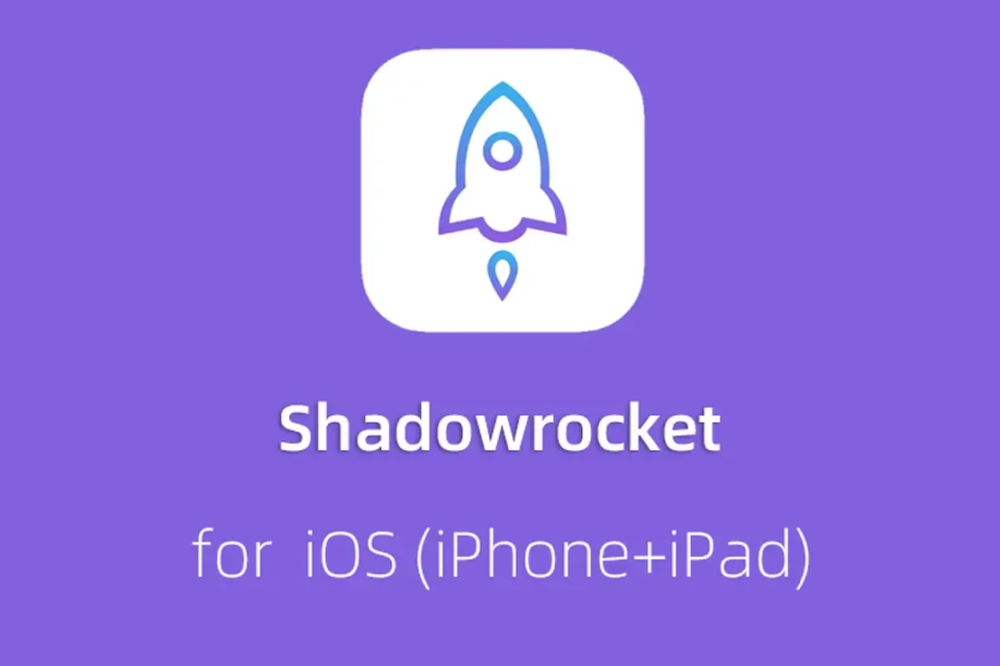
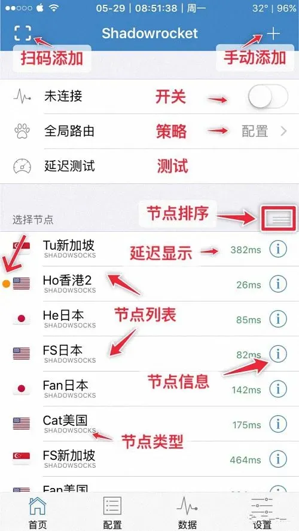

想用iPhone装小火箭，结果打开App Store一搜，发现中国区根本没有这个应用。这时候很多人会想到去买一个外区Apple ID，也就是大家常说的“AppleID小火箭买”这个操作。但这个操作背后有几个问题需要先弄清楚：买什么样的ID、从哪买、登录后怎么用、会不会被封。

这篇文章就围绕这几个问题展开，不绕弯子。

## 为什么小火箭必须用外区Apple ID下载

小火箭（Shadowrocket）在中国区App Store里是搜不到的，这跟App Store的分区审核规则有关。中国大陆区没有上架这个应用，所以想下载它，唯一的正规途径就是切换到其他区——美区、港区、台区、日区、韩区都有，具体看哪个区的App Store里能搜到。

用其他区Apple ID登录App Store后，商店界面会变成对应地区的版本，这时候搜索小火箭就能看到。下载完成后，可以退出这个ID，换回自己的中国区账号继续正常使用手机，应用不会消失。这是“AppleID小火箭买”这个需求存在的根本原因——你不需要换手机，只需要临时登录一个外区ID。

## 小火箭Apple ID有哪几种买法

### 独享Apple ID

独享就是一个Apple ID只归你一个人用，别人不知道账号密码，也不会同时登录。这种ID在购买后，通常建议自己修改密码，并且开启双重验证，让账号真正变成自己的。

独享的优势在于稳定，不会出现登录时突然被踢下线的情况，也不会因为别人乱操作导致账号被锁。用独享ID下载小火箭后，这个ID还可以留着以后更新应用用，不用每次更新都重新找账号。

需要注意的是，卖家给的“独享”有时候只是“当前只有你在用”，并不代表这个ID是全新注册的。所以购买后修改密码、绑定自己的手机号（如果允许）是比较稳妥的做法。

### 共享Apple ID

共享就是一个ID发给很多人用，大家用同一个账号密码登录App Store下载小火箭。这种方式价格便宜，但问题也多。

最典型的问题是掉线。你在App Store里登录共享ID下载小火箭，下载到一半提示“此Apple ID已被锁定”，或者下载完成后没几天，打开App Store提示需要重新验证账号密码。因为其他人在其他设备上也登录了这个ID，苹果的风控系统检测到频繁异地登录、多设备同时在线，会触发安全机制，轻则要求重新验证，重则直接锁定账号。

另一个问题是隐私。共享ID绑定的支付信息、iCloud备份、查找我的iPhone等设置，如果操作不当，可能影响到你手机上的其他数据。所以用共享ID下载小火箭时，建议只在App Store里登录，不要登录iCloud，也不要打开“查找我的iPhone”相关功能。

### 自建Apple ID

如果你愿意花几分钟时间，也可以自己注册一个外区Apple ID。注册流程本身不复杂，但需要满足几个条件：一个没注册过Apple ID的邮箱、一个能接收验证码的手机号，以及注册时选择的地区对应的支付方式——美区需要美国地址，港区需要香港地址，等等。

自建ID的好处是完全可控，不存在被共享、被锁定、被踢的问题。缺点是有一定门槛，尤其是支付信息那一步，有些地区不填支付方式也能注册，有些地区必须填，需要根据实际情况尝试。另外，自己注册的账号如果长期不用，也可能被苹果回收或锁定。

## 买小火箭Apple ID前要确认哪些信息

### 账号是哪个区的

不同区的App Store里小火箭的价格和可用性不完全一样。美区、港区、台区都有小火箭，但具体价格不同。买之前确认卖家给的ID是哪个区的，免得登录后发现该区没有小火箭，白忙一场。

### 是否支持修改密码和开启双重验证

这一点很关键。如果卖家说“不能修改密码”，那这个ID大概率是批量注册后拿来卖的，或者同时卖给了很多人。这种ID你下载完小火箭，过几天可能就被锁了。如果卖家允许修改密码，那买回来之后第一件事就是改密码，把账号控制在自己手里。

### 是否有绑定支付方式

有些外区ID绑定了信用卡，有些没有。如果绑定了别人的信用卡，你用这个ID下载付费应用时，扣的是别人的钱，这本身就有风险——一旦卡主发现并联系苹果，你的设备可能被风控。买之前问清楚，或者选择未绑定支付方式的ID。

### 是否支持后续更新

小火箭这类应用会不定期更新。如果你买的ID是一次性的，下载完就被卖家改密码或者收回，那以后应用更新时你就没法更新了。所以买的时候最好确认一下，这个ID是否支持后续更新，或者卖家是否承诺更新时提供帮助。

## 登录小火箭Apple ID后怎么下载和切换

拿到ID后，操作步骤并不复杂，但有几个细节值得注意。

打开手机上的App Store，点击右上角头像，退出当前账号，然后输入买来的外区ID和密码。登录后App Store会自动切换到对应地区，搜索“Shadowrocket”或“小火箭”，看到应用后点击获取或购买。下载过程中不要锁屏，不要切出去太久，否则可能会提示需要重新验证。

下载完成后，回到App Store右上角头像，退出外区ID，再登录回自己的中国区账号。这时候你手机桌面上已经有小火箭的图标了，打开就能用。

如果你用的是共享ID，下载完成后最好立刻退出，不要一直挂着共享ID在App Store里，否则别人操作时可能导致你的下载记录、已购项目列表被影响。

## 共享Apple ID买小火箭容易遇到哪些问题

### 被踢下线

这是最常遇到的情况。共享ID同时在线的人一多，苹果会强制要求重新验证，或者直接锁定账号。你正在下载，突然弹出“此Apple ID已被停用”，基本就是账号被锁了。解决办法通常是等一段时间再试，或者找卖家处理，但很多时候卖家也解决不了。

### 下载记录混乱

用共享ID下载小火箭后，你的App Store“已购项目”里会出现这个ID下载过的所有应用，包括别人下载的。这本身不算大问题，但如果你不小心点到了“更新全部”，可能会把一些你不想更新的应用也更新了，或者因为网络问题导致部分应用更新失败。

### 账号被锁导致应用无法更新

共享ID被锁后，你手机上用这个ID下载的应用在更新时会提示需要验证，但你验证不了，因为账号已经锁了。这时候小火箭就没法更新到最新版本，功能可能受限。

### 隐私风险

共享ID如果被用于iCloud登录，你的照片、通讯录、备忘录等可能被同步到这个共享账号上，其他登录这个ID的人理论上能看到。所以用共享ID时，绝对不要登录iCloud，只在App Store里用。

## 小火箭Apple ID账号安全与隐私注意事项

买来的ID，尤其是共享ID，使用起来有几个底线需要守住。

不要在共享ID上登录iCloud。iCloud是苹果账号体系里最敏感的部分，涉及照片、通讯录、钥匙串、查找我的iPhone等。共享ID登录iCloud，你的个人数据可能被其他人访问，风险很高。

不要开启“查找我的iPhone”里的“查找”功能，除非这个ID是你自己的。共享ID开启查找后，如果账号被锁，你的手机可能被激活锁限制，处理起来很麻烦。

买独享ID后，如果卖家允许，尽量修改密码并开启双重验证。这样即使卖家把账号信息泄露给别人，别人也登录不进来。

不要用买来的ID在App Store里购买付费应用，除非你确认这个ID绑定的支付方式是你自己的。用别人的支付方式买应用，轻则扣错钱，重则触发风控。

如果ID被锁，不要反复尝试输入密码，连续输错太多次会延长锁定时间，甚至需要联系苹果客服才能解锁。

## 买小火箭Apple ID前怎么判断靠不靠谱

### 看卖家是否提供售后服务

靠谱的卖家通常会承诺“如果账号被锁，免费换新”或“提供更新帮助”。如果卖家说“售出概不负责”，那这个ID可能是一次性的，买来用完就废。

### 看账号是否支持修改密码

能修改密码的ID，说明卖家没有把这个ID的密码控制在手里，或者至少愿意把控制权交给你。不能修改密码的ID，风险很高，不建议买。

### 看账号是否是新注册的

新注册的ID相对安全一些，因为还没被多人使用过，被锁的概率低。但新注册ID也有问题——如果注册时用的虚拟邮箱或临时手机号，苹果可能在后续验证时要求验证这些信息，你验证不了，账号就废了。

### 看价格是否合理

价格过低的“独享”ID，基本不可能是真的独享。价格过高的共享ID，性价比又不高。根据实际行情判断，通常独享ID比共享ID贵，但具体价格区间不好一概而论，需要根据卖家提供的账号情况来判断。

### 不要相信“永久有效”“永不掉线”之类的承诺

没有哪个外区ID是永久有效的。苹果的账号风控体系很敏感，一个ID被多人使用、频繁换设备登录，被锁是迟早的事。卖家说“永久”只是在吸引你下单，实际使用中该掉还是掉。

## 小火箭下载完成后还要做什么

小火箭下载安装后，还需要配置节点才能使用。这一步跟Apple ID本身无关，但很多人买完ID下载完小火箭，以为就完事了，结果打开软件发现没有节点，不知道怎么用。

小火箭本身只是一个客户端，你还需要导入节点信息。节点可以自己搭建，也可以从提供节点服务的渠道获取，通常是订阅链接或者二维码形式。打开小火箭，点击右上角“+”号，扫描二维码或粘贴订阅链接，就能导入节点列表，然后选择一个节点连接。

所以“AppleID小火箭买”这个操作，解决的只是“下载安装”这一步。后面的配置和使用，是另一个话题，这里就不展开了。

## 总结一下

买小火箭Apple ID，核心就三件事：确认账号类型（独享还是共享）、确认账号状态（能不能改密码、有没有绑定支付方式）、确认使用方式（只在App Store登录，不碰iCloud）。

独享ID适合长期使用、需要稳定更新的人，共享ID适合临时下载、不想多花钱的人。两者没有绝对好坏，关键看你自己的使用频率和风险承受能力。买之前多问一句，买之后第一时间改密码（如果允许），用的时候只在App Store登录，能避开大部分常见的坑。
