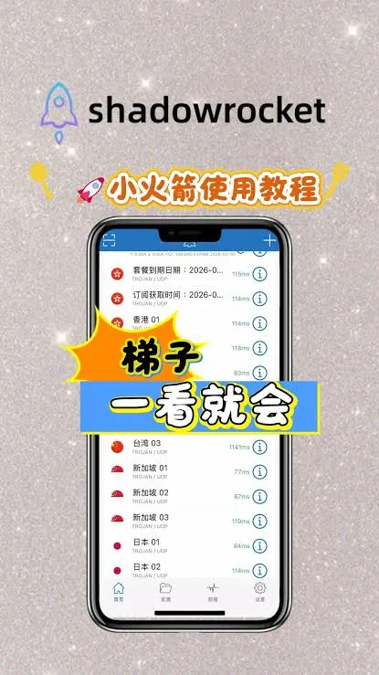

对于 iOS 用户来说，Shadowrocket（俗称小火箭）是几乎必不可少的工具。然而，由于该应用在某些地区的 App Store 下架，且需要付费购买，很多用户选择通过“共享苹果账号”来获取。这种方式虽然极大降低了获取门槛，但在实际使用过程中，很多用户会遇到各种让人头疼的问题：提示 ID 无效、无法下载、频繁退出登录，甚至账号直接被封。

本文将深入探讨共享苹果账号小火箭的使用逻辑，并针对用户最常遇到的痛点提供实操性的解决方案。

## 为什么共享苹果账号小火箭会频繁提示掉线？

很多用户在拿到共享 ID 后，起初用得很好，但过不了几天就会弹出“Apple ID 已失效”或“无法登录 App Store”。这并不是软件本身的问题，而是苹果官方的安全保护机制在起。

首先是**设备数量限制**。苹果对同一个 Apple ID 允许登录的设备数量有严格限制（通常为 10 台）。共享账号往往是给几十甚至上百人使用的，当人数超过上限时，新登录的用户就会踢掉先登录的用户，导致账号频繁掉线。

其次是**异地登录风控**。苹果的系统如果检测到账号在短时间内从多个地理位置、多个 IP 地址频繁切换登录，为了账号安全，会自动锁定该账号。这种情况下，用户会发现虽然密码正确，但依然提示“此 ID 目前无法验证”。

最后是**密码冲突**。由于共享账号的密码是公开的，一旦其中某个用户为了个人安全或恶意操作修改了密码，其他所有人的账号都会瞬间失效。

## 共享 ID 下载小火箭时弹出“需要验证”怎么办？

很多新手会发现，虽然成功登录了共享账号，但在点击下载或更新小火箭时，系统会弹出一个对话框要求验证信息。这时候如果直接点击“忽略”，往往会提示“地区信息不足”。

这通常是因为该共享账号没有完成完善的地区信息设置。苹果账号在首次在该设备上下载付费应用时，系统会要求填写账单地址、电话号码、支付方式等信息。

**应对建议：**
1. **千万不要填写个人信用卡信息**：共享账号是公共的，如果你绑定了个人信用卡或支付号，一旦绑定，你的隐私信息就会泄露给该账号的所有者。
2. **使用随机生成的地址**：在网上搜索“地址生成器”，获取对应地区（如美区、港区）的随机地址和电话进行填写。
3. **下载完立即退出**：一旦下载开始，请务必立即在 App Store 中退出该共享账号，换回自己的个人 ID。千万不要让共享账号一直处于登录状态，否则极易触发系统封禁。

## 共享账号使用中的隐私风险与规避方案

使用共享苹果账号小火箭虽然省钱，但背后的隐私风险是不容忽视的。很多用户容易犯的错误是：直接在 iOS 的“设置”中顶部登录 Apple ID。

这是极其危险的操作。如果你在“设置”里登录共享账号，你的 iCloud 照片、通讯录、短信、甚至设备位置都可能同步到这个公共账号下。这意味着该账号的主者或其他用户可能会看到你的隐私，甚至可以远程删除你的手机。

**正确的操作流程：**
*   **仅在 App Store 登录**：打开 App Store 应用，点击右上角头像，拉到最下方点击“退出”，然后在这里登录共享账号。
*   **下载完即走**：下载完 Shadowrocket 后，立即点击退出登录，并重新登录你自己的个人 Apple ID。
*   **关闭云同步**：如果你不小心在系统设置里登录了，请务必进入“Apple ID -> iCloud”，关闭所有数据同步开关，并选择“退出此设备”，防止数据外泄。

## 共享账号与独享账号：哪种方案更适合你？

在市场上，小火箭账号主要分为“共享”和“独享”两种。很多用户在纠结该选哪一个。

**共享苹果账号的特点：**
*   **优点**：价格极低，通常只需几块钱就能用一个月。
*   **缺点**：稳定性极差，经常掉线，需要频繁切换登录，容易遇到下载受限的问题。
*   **适用人群**：预算极其有限、偶尔使用一次、或者对稳定性要求不高的学生群体。

**独享账号的特点：**
*   **优点**：账号只有你一个人使用，不存在设备踢人问题，下载和更新非常顺畅，安全性极高。
*   **缺点**：价格远高于共享账号，通常是共享账号的数倍。
*   **适用人群**：重度用户、需要长期稳定网络环境、不希望频繁折腾设置的专业人士。

总结来说，如果你希望小火箭作为日常生产力工具，建议直接购买独享账号，避免频繁登录退出，浪费的时间成本远超省下的那点钱。

## 解决小火箭无法更新的常见排查步骤

有时候，即使账号正常，在更新小火箭时依然会报错“无法连接”。这通常可以通过以下步骤排查：

1. **检查网络环境**：尝试切换 Wi-Fi 或手机移动数据，或者开启飞行模式重置。有时候是苹果服务器的连接波动。
2. **清理 App Store 缓存**：在 App Store 页面连续点击右下角的图标多次，直到页面变黑并重新加载，这可以强制刷新缓存。
3. **确认地区一致性**：确保你下载小火箭的账号地区与当前登录的账号地区一致。美区下载的应用在港区是无法更新的。
4. **卸载重装**：如果以上方法都无效，最后的办法是卸载旧版本（注意：这会丢失你的配置，请务必提前备份配置订阅），然后重新用共享账号下载。

使用共享苹果账号获取小火箭确实是一个低成本的方案，但前提是用户必须具备基本的安全意识。通过坚持“只在 App Store 登录”、“下载完即退出”的原则，可以规避 90% 以上的隐私和掉线风险。
