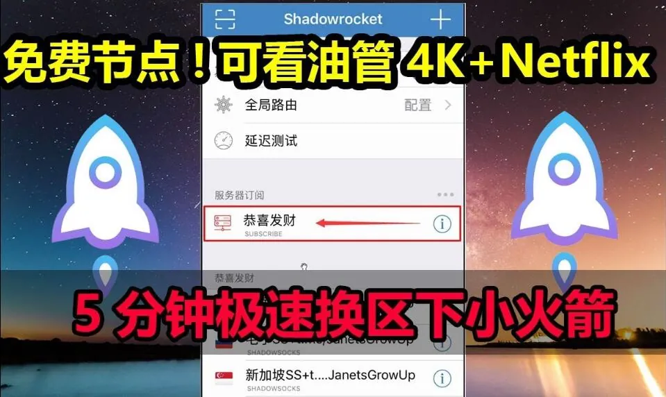
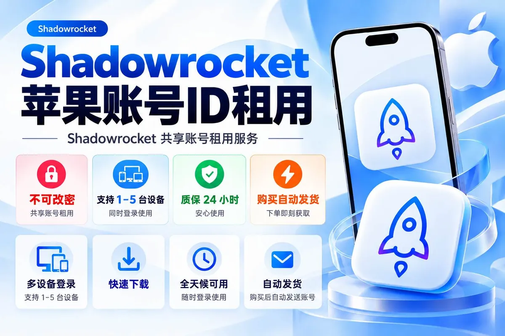

有人的做法是：在一个群里翻到别人发的免费共享id，登录 App Store 把 Shadowrocket 下载下来，当晚用得挺顺，第二天想更新一下，密码已经不对了。再回去问，发号的人说“被改了，等下一批”。这种循环在找免费共享id的人里并不少见——省下的是买断费用，付出的是反复折腾的时间，以及一些不容易被注意到的隐私代价。

下面按“它到底怎么来的、为什么会失效、登录时要注意什么、和独享差在哪、哪些人其实不该用”这条线说清楚。

## 免费共享id的账号是从哪来的

所谓免费共享id，通常指一个 Apple ID 被公开或半公开地分发给一群人使用，主要用途是登录 App Store 下载需要付费或者所在地区没有上架的 App，小火箭（Shadowrocket）是最典型的一个。因为它在多数地区的 App Store 里是付费应用，而且国区并不上架，所以想用的人要么自己注册对应地区的账号买，要么去用别人已经买过的账号。

免费的那一类，来源大致有几种：

- 有人自己买了 App，把账号贴出来“做公益”，但这种情况往往撑不了多久；
- 有人批量持有账号，用免费的名义引流，真正的目是后续卖别的东西；
- 账号本身就是通过非正常途径得来的，随时可能被原主人找回或被平台处理。

这三种来源的稳定性差别很大，但对外表现是一样的：你拿到手的只是一串账号和密码，看不到它背后谁在管、还能用多久。

## 免费共享id为什么经常一两天就失效

失效的原因基本跑不出这几类，而且大多和“免费”这个属性直接相关。

**密码被改。** 共享账号的密码是公开的，任何人登录后都有可能去改密码或者改绑定的邮箱、手机号。一旦有人这么做，后面所有人都进不去。这不是意外，是共享模式的必然结果。

**同时登录设备过多触发风控。** 一个 Apple ID 短时间内从多个城市、多台设备登录，平台侧通常会判定异常，要求验证身份或者直接锁定。免费共享id因为使用人数不可控，撞上这条的概率很高。

**被原持有者收回。** 有些账号是“借出来”的，持有人自己要用，或者发现被滥用，就把密码换掉。

**账号被停用。** 长期高频异地登录、被多人举报，账号可能进入不可用状态。这种情况连发号的人都救不回来。

所以判断一个免费共享id能不能用，不能看“现在能不能登上”，而要看“有多少人在同时用它”。前者是瞬时状态，后者决定了它还剩多久。

## 登录共享id时，哪些操作会带来麻烦

这一步是很多人出问题的地方，而且问题往往不是账号失效，是自己设备上的东西被同步走了。

**只在 App Store 里登录，不要登 iCloud。** 下载 App 需要的只是商店账号，在“设置”顶部的 iCloud 位置登录一个陌生账号，意味着照片、通讯录、备忘录、备份都有可能开始往那个账号上同步。共享账号的密码是公开的，等于把这些内容的访问权也交了出去。真要下载，走 App Store 应用内的账号切换入口。

**关掉自动同步和“查找”。** 如果已经在设置里登录了，尽快退出，并检查有没有开启 iCloud 备份、通讯录同步这类选项。有些账号被开启“查找我的 iPhone”后，退出时会要求输入该账号的密码，而密码可能已经被别人改掉，设备就会被卡住。

**不要在这个账号上绑定自己的支付方式。** 共享账号绑定的付款信息不属于你，你也不该往里加自己的卡。

**下载完成后及时退出登录。** 尤其是公用设备或者主力手机，长期挂着别人的账号没有好处。已下载的 App 在退出账号后一般还能继续用，但更新时可能需要重新登录，这一点要有心理准备。

还有一条常被忽略：不要在共享账号的备忘录、通讯录里留下任何自己的信息。那相当于把内容写在了别人的本子上。

## 共享id和独享账号，实际体验差在哪

把两者放在一起看会更清楚。这里说的独享，指一个人单独持有、只有自己知道密码的账号。

| 对比项 | 免费共享id | 独享账号 |
| --- | --- | --- |
| 密码控制权 | 多人知晓，随时可能被改 | 只有自己知道，可自行修改 |
| 同时在线人数 | 不可控，可能几十上百 | 通常只有自己的几台设备 |
| 稳定性 | 短期可用，随时失效 | 取决于自己是否违规使用 |
| 更新 App | 经常需要重新验证，失败率高 | 正常更新 |
| 隐私风险 | 较高，iCloud 同步需格外小心 | 低，账号归自己 |
| 成本 | 无直接费用，时间成本高 | 需要一次性支出 |
| 售后 | 基本没有，发号的人不承担责任 | 自己管理，出问题可自行找回 |

表格里最容易被低估的是“更新”这一栏。小火箭这类工具会跟随系统版本更新，iOS 大版本升级后旧版本可能无法使用，这时候必须回 App Store 更新，而更新就要重新验证账号。共享id在这个环节掉链子的概率非常高——你手里那个账号可能早就不能用了。

另一个被低估的是找回能力。独享账号如果自己忘了密码，还能通过绑定的邮箱或手机号找回；共享账号你既没有绑定信息，也没有原始凭证，出问题只能换一个。

## 便宜的共享id和“免费”的，风险其实不一样

市面上也有按时间卖的共享账号，几块钱用一个月那种。它和完全免费的在性质上接近，但有一处区别值得说：收费的共享号通常有个“管理者”，账号失效后可能补发，免费的基本没有这层保障。不过反过来说，收费共享号的使用人数往往更多，因为卖家要摊薄成本，被踢和限速的概率未必更低。

真正要警惕的是那种“免费送号”但要求你先做点什么的：关注、转发、填手机号、加群、下载某个来路不明的描述文件。账号本身可能只是个诱饵，目的是收集信息或者引导安装其他东西。遇到需要提供手机号、验证码、Apple ID 密码（注意，是让你交出自己账号的密码）的，直接放弃，这类要求没有正当理由。

## 判断一个共享id来源靠不靠谱，看这几处

如果确实要用共享账号，下面这些信号可以作为参考，它们不能保证安全，但能筛掉一部分明显不行的。

- **发放方式是否公开透明。** 是固定渠道定期更新，还是私聊随机发，前者至少有人维护。
- **有没有说明使用规则。** 比如“只登 App Store”“不要开查找”“不要改密码”。愿意写清楚规则的，通常也知道哪些操作会毁号。
- **账号地区是否和 App 对应。** 下载小火箭需要的账号地区必须匹配，地区不对根本搜不到这个 App，这能反过来验证发号的人是否真的懂。
- **是否要求你提供个人信息。** 正常的共享账号发放不需要你的手机号、身份证或者你自己的 Apple ID 密码。
- **历史反馈。** 同一个人发的号如果经常有人反馈“当天就失效”，说明维护能力有限。

需要提醒的是，以上判断只能降低踩坑概率，改变不了共享账号“密码多人可知”这个前提。

## 哪些人其实不适合用免费共享id

说句实在话，不是所有人都该省这笔钱。

如果你只是临时需要下载一次，用完就不再更新，那共享账号够用，注意退出登录、别碰 iCloud 就行。

但如果你属于下面几种情况，共享id会持续给你添麻烦：

- **把它当日常工具长期用。** 小火箭需要跟随系统更新，每次更新都是一次验证，共享号撑不到那时候。
- **在主力手机上用。** 主力机上有照片、聊天记录、支付信息，为了一个 App 去登录陌生账号，风险收益不对等。
- **需要多设备同步配置。** 共享账号你不敢开 iCloud 同步，规则和节点配置就得手动搬，反而更费事。
- **对稳定性有要求。** 正用着突然要更新，或者账号被锁需要重新找号，这种中断在关键时刻很要命。

对这些情况，自己持有一个账号更省心。一次性支出换来的是密码控制权、更新能力和找回能力，这三点恰恰是共享模式给不了的。

## 已经用了免费共享id，现在该做什么

如果你手上正挂着一个共享账号，可以做几件事收尾：

先确认登录位置。打开设置看顶部有没有陌生账号，有的话退出来，退出前留意会不会要求输入密码，如果被“查找我的 iPhone”卡住，说明这个账号已经影响到设备了，需要尽快处理。

再检查同步项。iCloud 里的照片、通讯录、备忘录、备份，确认没有往共享账号上跑。已经同步上去的内容，退出账号后建议改一下相关账号的密码。

然后把已下载的 App 更新到当前可用版本，避免之后账号失效、想更新又登不上。

最后，如果这个 App 你要长期用，认真考虑换成一个自己能掌控的账号。免费共享id的本质是“借用别人的钥匙”，钥匙什么时候被换、被谁配过，你都不知道。省下的钱不多，搭进去的时间和隐私，往往比那点费用贵。
