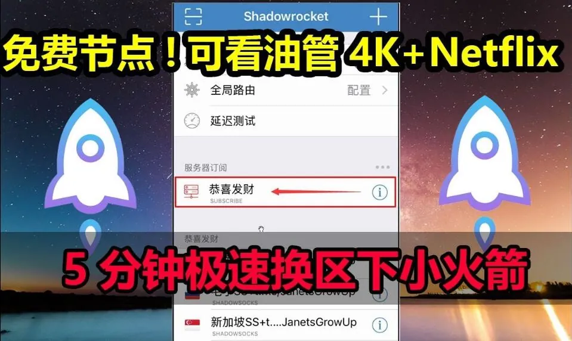

在App Store里点下下载，进度条走到一半停住，弹出「此Apple ID已在多台设备上使用」或者直接要求输入验证码——这是不少人第一次接触Shadowrocket共享id时的真实体验。共享id本身不是什么复杂的东西，但它牵扯到Apple ID的登录规则、双重验证、设备绑定和隐私边界，任何一环没处理好，都会变成下载失败、频繁掉线或者账号被锁。

下面按实际使用的顺序，把共享id从登录到退出、再到后续更新会遇到的情况拆开说。

## 共享id共享的到底是什么

Shadowrocket是付费应用，下载它需要一个已经购买过该应用的Apple ID。共享id的做法是：有人用自己的账号买下应用，再把账号信息提供给多人，让大家轮流登录App Store完成下载。

这里要先分清两件事：

- **App Store登录**：只影响应用下载和购买记录，登录后可以下载该账号已购的应用。
- **iCloud登录**：影响照片、通讯录、备忘录、设备备份、查找我的iPhone。

共享id只能用于前者。很多人出问题，就是把共享账号登进了设置顶部的iCloud，结果通讯录混进别人的数据、照片开始同步，甚至设备被「查找」功能锁定。这个界限一旦跨过，后面收拾起来很麻烦。

## 登录共享id之后下载不了，通常卡在哪

下载失败的原因不止一种，按出现频率排下来大概是这几类。

**双重验证拦截。** 苹果对Apple ID的双重验证越来越严格，部分共享账号在异地、多设备登录时会触发验证码，而验证码只会发到账号绑定手机或受信任设备上。使用共享id的人拿不到验证码，登录就停在半路。这种情况不是操作错误，是账号本身的配置不适合共享。

**登录位置不对。** 正确的入口是「设置 → 顶部Apple ID → 媒体与购买项目 → 退出登录」，或者直接打开App Store点右上角头像退出再登录。如果在「设置」首页最上方直接登录，系统会默认你要登iCloud，很容易连带开启同步。

**同时在线人数过多。** 一个账号被几十台设备轮流登录，苹果的风控会判定异常，表现为提示账号被锁定、需要重设密码，或者已购项目列表突然清空。这类问题在使用高峰期尤其明显。

**账号被前一个使用者改过密码。** 共享id的密码理论上不该被修改，但总有人手滑或者出于其他目的改了，后面的人全部登不上。这也是共享模式最不可控的地方。

## 下载完成就退出，这个动作别省

小火箭装好之后，正确的做法是立刻回到App Store退出共享账号，换回自己的Apple ID。原因有几个：

1. 长期挂着别人的账号，你的下载记录、更新请求都会走这个账号，一旦对方改密码，你的应用更新就会卡住。
2. 账号在多地同时在线，容易触发安全验证，把你自己也搭进去。
3. 如果这个账号后续被举报或封禁，登录过它的设备在部分情况下会被要求重新验证。

退出之后再打开小火箭，应用本身可以正常使用，因为应用已经安装到设备上，运行不依赖App Store的登录状态。

## 共享id和独享账号，差别不只在人数

不少人纠结要不要用共享id，本质上是在权衡成本和麻烦程度。把两者放在一起看会更清楚：

| 对比项 | 共享id | 独享账号 |
| --- | --- | --- |
| 同时使用人数 | 多人轮流，通常不固定 | 仅自己使用 |
| 登录冲突 | 较常见，高峰期更容易触发验证 | 基本不存在 |
| 隐私暴露面 | 账号信息对多人可见，存在被滥用可能 | 仅自己掌握 |
| 应用更新 | 依赖账号可用，密码被改就中断 | 稳定，可长期更新 |
| 账号被锁影响 | 影响所有使用者 | 只影响自己 |
| 适合人群 | 临时下载、一次性使用 | 长期使用、有多台设备 |

需要说明的是，独享账号也不是绝对安全，它的风险主要来自账号来源是否正规。如果账号本身是通过异常手段注册或购买的，后续一样可能被苹果回收。区别在于，独享出问题时你只需要处理自己的设备，共享出问题时你连问题出在谁身上都不知道。

## 被踢下线、已购项目消失是怎么回事

这两个现象经常一起出现，背后机制类似。

「被踢下线」通常指App Store突然要求重新登录，或者提示账号在其他设备登录。共享账号的设备数没有硬性上限，但苹果会根据登录地点、设备型号、时间间隔判断是否存在异常共享行为。当判定成立，账号可能被临时锁定，所有人同时掉线。

「已购项目消失」则是另一种情况。App Store的已购列表是按账号走的，如果账号被限制，或者登录状态异常，列表会显示为空。这时候不要急着重装应用，先确认账号是否能正常登录，再检查网络环境。有些情况下只是地区设置和当前网络不匹配，切换网络后列表会恢复。

如果账号确实被锁，唯一的处理方式是账号持有人通过苹果的账号恢复流程解锁。使用共享id的人在这个过程中没有任何操作空间，只能等或者换号。

## 用共享id时最容易被忽略的隐私风险

这部分值得单独说，因为它的后果比下载失败严重得多。

**不要把共享账号登进iCloud。** 一旦登录，设备会询问是否合并通讯录、备忘录、Safari书签等数据。选择合并，你的个人信息就进入了这个账号的云端；选择不合并，也可能在后续同步中被覆盖。更麻烦的是「查找我的iPhone」，如果这个开关被开启并绑定到共享账号，账号持有人理论上可以对设备执行远程锁定或抹除。

**不要在共享账号里保存支付信息。** 部分共享id可能绑定了付款方式，登录后如果误操作购买了其他应用，扣款归属和退款都会变得很难处理。

**不要用共享账号登录其他苹果服务。** iMessage、FaceTime、iCloud钥匙串都不适合，这些服务与身份绑定，混用会带来持续的验证干扰。

**注意账号来源。** 来源不明的共享id可能本身就是被盗用的账号，使用这类账号不仅随时失效，还可能在你不知情的情况下把设备信息暴露给第三方。遇到要求提供自己Apple ID密码、验证码或者要求关闭设备安全设置的「共享服务」，直接放弃。

## 判断一个共享id能不能用，看这几件事

没有绝对可靠的标准，但有几个信号可以帮助判断。

- **是否明确限定登录位置。** 靠谱的提供方会写清楚「仅登录App Store，禁止登录iCloud」，而不是含糊地说「按教程操作」。
- **是否说明账号的使用状态。** 比如账号是否开启双重验证、是否需要验证码、地区是哪个。这些信息决定了你能不能顺利登录。
- **是否提示同时在线限制。** 完全不提人数和使用高峰的，通常意味着账号被大量分发。
- **是否提供异常处理方式。** 账号失效后能不能换、怎么换，这些在事前说清楚比事后扯皮有用。
- **是否要求你提供敏感信息。** 只需要账号密码，不需要你的手机号、验证码、身份证或设备管理权限。

反过来，那些承诺「永久可用」「无限设备」「绝不掉线」的说法，基本可以不用考虑。Apple ID的状态受苹果风控影响，没有任何提供方能做出这种保证。

## 已经装好了，后续更新怎么办

小火箭的更新同样走App Store，而App Store的更新校验的是当初下载时使用的Apple ID。也就是说，如果共享id的密码被改了、账号被锁了，你点更新会一直提示输入密码，应用停留在旧版本。

处理方式有几种，各有取舍：

- **继续用旧版本。** 小火箭的核心功能相对稳定，旧版本在多数情况下可以继续使用，只是新协议或系统适配可能跟不上。
- **用另一个可用账号重新下载。** 前提是那个账号已经购买过该应用，否则会走购买流程。
- **改用独享账号。** 如果你长期依赖这个工具，把更新链路掌握在自己手里会省掉很多反复找账号的时间。

顺带提一句，卸载重装并不能解决更新问题，因为重装时仍然需要原账号的授权。有些人在更新失败后反复卸载，结果连旧版本都没了，反而更麻烦。

---

共享id解决的是「一次性拿到应用」的问题，它不适合被当成长期方案。真正决定使用体验的，是你能不能清楚地区分App Store登录和iCloud登录、能不能在下载完成后及时退出、以及能不能识别出那些明显不合理的承诺。把这几个环节做对，共享id可以是一个低成本的过渡选择；做错其中任何一个，付出的代价往往比省下的麻烦更大。
