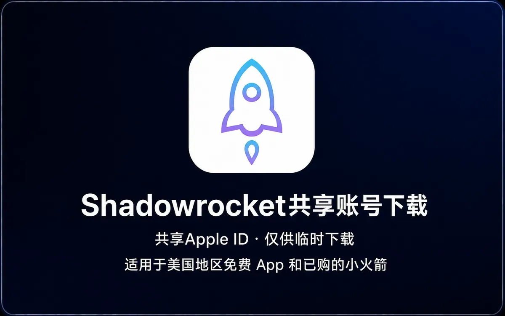
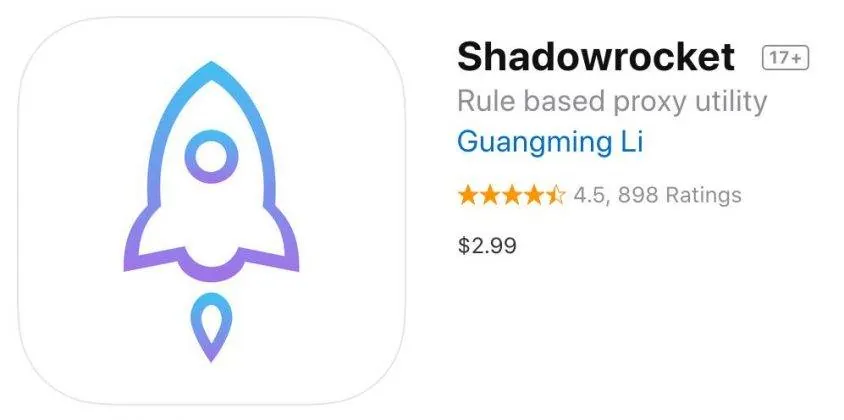
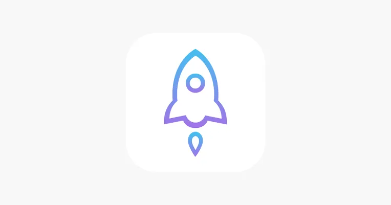

想装 Shadowrocket，在国区 App Store 搜不到，于是转向美区账号——这是很多人第一次接触“Shadowrocket美区共享id”的场景。搜索结果里到处是“共享ID”“免费领取”“一人一号”的说法，看起来门槛很低，但真正登录进去之后，问题才开始出现：密码不对、账号被锁定、下载到一半被踢下线、更新时提示需要验证。共享美区 ID 并不是不能用，而是它的使用方式和独享账号差别很大，弄不清楚就容易白折腾。

## 共享美区 ID 解决的是哪个环节的问题

Shadowrocket 是美区 App Store 上的付费应用，国区账号无法直接购买和下载。共享美区 ID 的本质，是有人已经用这个账号买过这款应用，然后把账号信息提供给多人登录，让后来者通过“已购项目”把它下载下来。

它解决的是**下载入口**的问题，不解决账号归属。也就是说，你拿到的是一个多人共用的登录凭证，而不是一个属于你的 Apple ID。这一点决定了后面所有使用体验：账号可能随时被改密码、可能因为异地登录过多被 Apple 临时锁定、可能在你更新应用时失效。

需要区分两种情况：

- **只在 App Store 登录**：用来搜索、下载、更新应用，对个人数据影响较小。
- **登录到 iCloud**：会同步通讯录、照片、备忘录、 Safari 书签，甚至影响“查找”功能。共享账号绝对不能用于这一层。

很多人出问题，不是因为共享 ID 本身不能用，而是把这两件事混在了一起。

## 登录 App Store 和登录 iCloud 完全是两回事

iPhone 的设置里有两个入口，长得像，后果差很远。

在「设置」顶部点击头像进入的那一层，是 Apple ID 的总入口，登录后会影响 iCloud、App Store、iMessage、FaceTime 等全部服务。共享账号不要在这里登录。

正确的做法是进入「设置 → App Store」，或者直接在 App Store 应用内点右上角头像，滑到最底部退出当前账号，再输入共享 ID。这样只影响商店的下载权限，不会把设备数据挂到别人的账号上。

登录过程中如果弹出“Apple ID 安全提示”或要求双重认证，说明这个账号开启了二次验证。共享账号一旦开启双重验证，其他人基本无法登录，因为验证码会发到号主设备上。遇到这种情况，不要尝试反复输入或猜测验证码，直接换一个可用的账号更实际。

还有一点容易被忽略：从共享 ID 下载应用后，如果切换回自己的账号，应用仍然可以继续使用，但**更新时会要求输入当初下载时使用的账号密码**。所以要么记住这个共享 ID，要么在下载完成后及时更新，避免以后想更新却找不到账号。

## 为什么共享 ID 总是提示密码错误或被锁定

共享账号最常见的两类故障，原因不太一样。

**密码错误**通常有三种可能：号主改了密码但没有同步给所有人；输入时多了空格或全角字符；账号本身已经失效。共享 ID 的密码经常被复制传播，改动后旧密码不会自动更新，所以“昨天还能用，今天不行了”是常态。

**账号被锁定**更多和登录行为有关。Apple 对异地、多设备、短时间高频登录比较敏感，一个账号同时在北京、广州、海外多处登录，很容易触发安全机制，表现为提示“此 Apple ID 已被锁定”或“需要验证身份”。共享人数越多，触发概率越高。

这类锁定通常无法由使用者自行解除，因为验证方式掌握在号主手里。能做的只有联系提供方，或者换一个账号。反复尝试登录只会让锁定状态更难恢复。

## 多人同时在线会碰到哪些冲突

共享 ID 的“共享”二字，落到实际使用中就是资源竞争。

- **下载排队**：同一时间多人下载，可能出现进度卡住或提示“无法连接 App Store”。
- **已购项目变动**：号主如果隐藏了已购项目，或者账号被重置，应用会从已购列表里消失。
- **更新冲突**：一个人正在更新，另一个人同时登录，可能互相把对方挤下线。
- **家庭共享干扰**：部分共享账号加入了家庭组，成员变动会影响可用性。

这些冲突没有技术手段能彻底避免，只能通过错峰使用、减少同时登录设备数来降低概率。如果你只是偶尔下载一次，用完就退出，影响不大；如果依赖它长期更新应用，共享账号并不合适。

## 共享 ID 和独享账号，差别不只在价格

| 对比项 | 共享美区 ID | 独享美区账号 |
| --- | --- | --- |
| 登录人数 | 多人共用，数量不固定 | 仅本人使用 |
| 稳定性 | 受他人行为影响，可能被改密或锁定 | 自己控制，风险来源少 |
| 隐私风险 | 账号信息在多人之间流转 | 信息不外泄 |
| 能否改密码 | 通常不能，改了别人无法使用 | 可以自行修改 |
| 更新应用 | 需保留原账号信息，可能失效 | 长期可用 |
| 成本 | 较低甚至免费 | 通常更高 |
| 适合场景 | 临时下载、一次性使用 | 长期使用、多设备、需要更新 |

如果只是想在某一台设备上装一次 Shadowrocket，之后不再频繁更新，共享 ID 够用。如果要在手机、平板、电脑多处使用，或者不希望某天突然被踢下线，独享账号省心得多。

## 拿到一个共享 ID 后，先做这几步检查

第一步，确认登录位置。只在 App Store 内登录，不碰设置顶部的 Apple ID 入口。

第二步，看账号是否能正常进入商店。登录后如果能切换到美区界面、看到美元标价的应用，说明地区正确；如果仍然是国区内容，检查是否切换成功。

第三步，搜索 Shadowrocket，进入应用页面，看按钮是显示价格还是云朵下载图标。显示云朵说明该账号已购，可以直接下载；显示价格说明未购买，这个账号对你没用。

第四步，下载完成后立即退出账号。不要停留在登录状态，也不要在设置里保留这个账号。

第五步，记录下载时使用的账号信息，方便以后更新。如果账号随后失效，应用本身仍能打开，只是无法通过 App Store 更新。

## 使用共享 ID 时容易忽略的安全问题

共享账号的信息在多人之间传递，意味着密码、绑定的邮箱、甚至部分账号资料可能被无关的人看到。有几点需要守住：

- **不要绑定自己的手机号或邮箱**。共享账号的找回方式不属于你，绑定后反而可能影响原账号。
- **不要开启双重认证**。开启后其他人无法登录，也会让账号状态更复杂。
- **不要在 iCloud 层登录**。通讯录、照片、备份都可能同步到共享账号下，退出时还可能被要求保留数据。
- **不要用共享账号进行任何购买**。包括内购、订阅，付款方式不属于你，退款和纠纷都无法处理。
- **来源不明的账号谨慎使用**。频繁被举报、被多人转发的账号，被锁定或回收的概率更高。

还有一条常被忽视：从共享 ID 下载的应用，其签名和更新权限与原账号绑定。如果账号被 Apple 封禁，应用可能在某次系统更新后无法打开。这不是危言耸听，而是共享机制本身决定的。

## 遇到“无法登录”“账号已停用”怎么处理

先排除本地问题：确认网络能正常访问 App Store，确认没有开启限制安装的屏幕使用时间设置，确认输入的账号密码没有多余字符。

如果提示“此 Apple ID 已停用”，通常是账号触发了平台风控，使用者无法自行恢复。这种情况下继续尝试没有意义，联系提供方更换账号，或者改用独享账号。

如果提示“无法连接到 App Store”，可以先退出账号，重启 App Store，再重新登录，有时是缓存问题。切换网络、关闭再打开飞行模式也有帮助。

如果下载一直转圈，检查是否同时登录了多个 Apple ID，或者在「设置 → 通用 → iPhone 存储空间」里确认是否有足够空间。共享账号本身不限制下载速度，但多人同时使用会挤占连接。

## 到底该不该用共享美区 ID

这个问题没有统一答案，取决于你把它当成一次性工具还是长期依赖。

临时装一个应用、用完就不再折腾，共享 ID 的成本最低，注意别登录 iCloud、别绑定个人信息即可。需要长期使用、多设备同步、不希望某天更新失败，独享账号更稳，代价是需要自己注册或购买，并且自行承担账号维护。

至于网上各种“Shadowrocket美区共享id免费领取”的渠道，判断标准其实很简单：看它是否明确说明账号的使用范围、是否提示不要登录 iCloud、是否提供失效后的处理方式。只给一串账号密码、其余一概不提的，通常用不久。账号这东西，稳定从来不是免费的，共享的便利和它的不确定性是绑在一起的。
