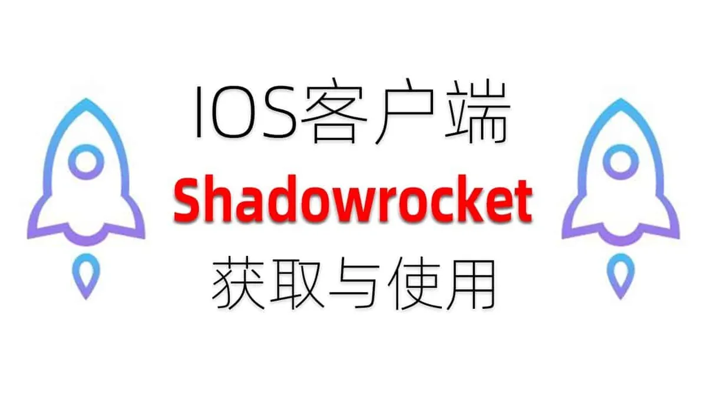
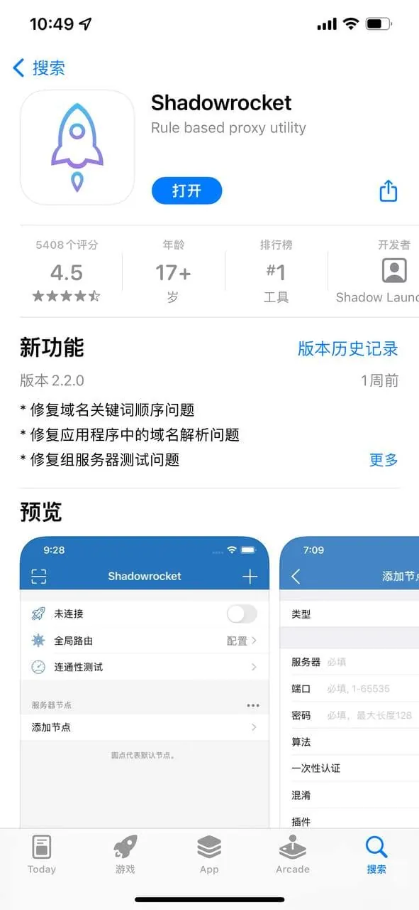

在 iOS 生态中，Shadowrocket（俗称小火箭）几乎是很多进阶用户的必备工具。然而，由于地区限制，中国大陆地区的 App Store 无法搜索到这款应用。这导致很多用户在尝试安装时，不得不寻找国外id小火箭的解决方案。在实际操作中，用户往往会遇到下载失败、地区锁死、账号登录后无法更新等各种问题。理解国外 ID 的运作逻辑以及如何规避常见的账号风险，不仅是顺利用到软件的前提，更是确保设备能够长期稳定运行的关键。

## 为什么必须使用国外ID才能下载小火箭

Shadowrocket 是一款付费软件，其分发策略仅限于特定的地区 App Store。由于苹果政策的区域调整，不同国家或地区的应用商店内容是完全隔离的。中国区 App Store 并没有收架该应用，因此，普通的国区账号是无法直接搜索下载的。

为了解决这个问题，用户需要一个非中国地区的 Apple ID。目前主流的方案包括美区、港区、日区或其他海外地区。只有登录了这些非大陆地区的 Apple ID，才能进入对应的应用商店进行搜索和购买。在这个过程中，很多用户会混淆“网络环境”和“账号环境”的区别，这往往是后续出现下载报错的根源。

## 国外ID的获取方式及其优劣对比

在获取国外id小火箭账号的过程中，用户通常面临两种选择：自己注册新账号或购买现成账号。这两种者的体验差异巨大，直接影响了后续软件的稳定性。

### 自行注册海外账号
通过苹果官网配合特定的网络环境，用户可以尝试自己注册全新的海外 ID。这种方式的优点是安全性高，账号和密码完全掌握在自己手中，不存在被他人恶意修改的风险。但缺点是门槛较高，注册往往需要真实的海外手机号、特定的支付方式（如当地信用卡或礼品卡），以及对网络环境纯净度的极高要求，新手容易在注册阶段被系统拦截。

### 购买现成账号的注意事项
为了省事，许多人会选择直接购买现成的账号。市面上的国外id小火箭账号通常分为“共享版”和“独享版”两种。

*   **共享账号**：多个用户共用一个 ID。优点是价格极其便宜，但缺点是极不稳定。因为多人同时登录会触发苹果的安全保护机制，导致频繁掉线、无法下载，甚至账号因违规被封禁。
*   **独享账号**：一个账号只给一个用户使用。这种稳定性最高，不会出现登录冲突，但价格相对较高，且需要信任卖方。

## 登录国外ID下载小火箭的正确步骤

即便有了国外账号，如果操作不当，依然可能导致“此项目不可用”或“无法验证账号”的错误。以下是比较稳妥的操作逻辑：

1.  **退出国区账号**：在 App Store 中点击右上角，拉到最下方点击退出。注意，不要在系统设置里直接退出 iCloud，只需在 App Store 内部退出即可。
2.  **登录国外账号**：在 App Store 登录准备好的国外 ID 和密码。
3.  **完成首次验证**：首次登录海外账号并下载时，系统通常会提示“此 Apple ID尚未在 iTunes Store 使用”。此时点击“检查”，并填写地址信息。在选择支付方式时，建议选择“无（None）”，以避免绑定信用卡。
4.  **填写地址信息**：由于地址、城市、邮编必须与账号地区对应，建议使用对应地区的免税州地址（如美国的俄勒冈州等），这样可以避免产生额外的购买税费。
5.  **搜索并下载**：验证完成后，搜索 Shadowrocket 即可完成购买与下载。

## 小火箭下载后频繁出现的报错及排查排查

很多用户在成功下载后，在后续使用或更新时会遇到棘手问题，这些问题往往不是软件本身，而是环境导致的。

### 提示“此项目在所在的地区不可用”
这通常是因为你当前的网络环境与账号地区不符，或者该应用在某些特定地区下架了。解决方法是尝试切换网络节点，并检查当前 App Store 登录的账号否为那个国外 ID。

### 更新软件时提示旧账号密码
这是最让用户困疼的问题。当小火箭发布更新时，系统会要求输入下载该软件时的 ID 密码。如果你已经切换回了国区账号，就会无法更新。
**解决方案**：在更新前，必须重新登录那个国外 ID，进入 App Store 的“更新”列表，更新完成后后再切换回国区账号。

### 账号频繁掉线或无法登录
这多发生于共享账号上。当多个设备在不同 IP 下频繁登录同一个账号，苹果会判定为异常登录并锁定。如果遇到这种情况，通常建议放弃该共享账号，更换为稳定的独享账号。

## 使用国外ID时的隐私与安全防范

在使用国外id小火箭的过程中，安全问题不容忽视。由于涉及到跨区域账号操作，用户需要养成良好的数字安全习惯。

*   **不要在系统设置中登录 iCloud**：这是最重要的一点。请务必只在 App Store 内部登录国外 ID。如果你在手机“设置”里登录了国外 iCloud，你的照片、联系人、信息等隐私数据都会同步到该海外账号，一旦账号被封，你的手机个人数据可能无法同步。
*   **避免在国外账号内下载敏感应用**：除了下载小火箭这类工具外，尽量不要在同一个国外 ID 下下载涉及支付、社交或高度隐私的 App，防止账号风险波动导致数据泄露。
*   **保护好账号密码**：如果是购买的独享账号，务必第一时间修改初始密码，并不要泄露给第三方。

## 总结与建议

对于追求体验的用户来说，获取一个稳定的国外 ID 是使用小火箭的第一步。如果你具备一定的技术能力，建议通过合法渠道注册一个美区或日区账号作为长久之计；如果你追求效率，则应选择靠谱渠道购买独享账号，并避开廉价的共享 ID。在整个使用过程中，始终记住“只在 App Store 登录”的原则，就能避免绝大部分的隐私和系统冲突问题。
