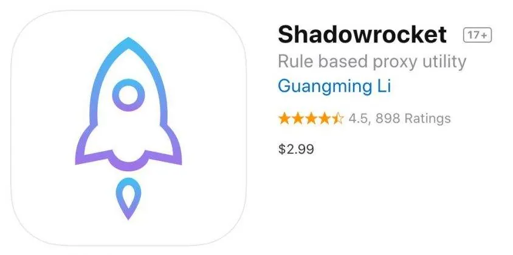

想在App Store里下载一个只在美区、港区或日区上架的应用，搜了半天却只看到“此项目在您所在的国家或地区不可用”。不少人这时会去搜外区苹果id共享账号，希望借一个现成账号把应用装下来。账号确实能借到，但登录的位置、使用的边界、可能遇到的问题，往往比“能不能登上”更值得先弄明白。

## 外区苹果id共享账号到底是什么

简单说，它是一组注册在非中国大陆地区的Apple ID邮箱和密码。注册人把账号信息提供给多人使用，大家用同一组凭据登录App Store，从而访问该地区的应用商店内容。

共享账号之所以存在，通常有几个原因：外区账号注册往往需要当地手机号、地址或支付方式，门槛不低；单个账号买断或订阅的成本，由多人分摊后更低；有些人只是临时下载一两个应用，不想长期维护一个外区账号。

从使用形态上看，常见的有两类。一类是公开分享型，账号密码在某个页面或群组里贴出来，谁看到谁用；另一类是有限共享型，由组织者控制人数，定期更换密码。前者获取方便，但稳定性通常很差；后者体验稍好，仍然改变不了“多人共用一个身份”的事实。

需要明确的是，苹果的用户条款并不鼓励账号共享和转让。平台侧对异常登录有风控机制，这也是共享账号经常出问题的根源。

## 为什么共享账号登上去没多久就被踢下线

这是使用外区苹果id共享账号时反馈最多的情况。原因并不神秘，主要来自几个方面。

**多地登录触发风控。** 同一个账号在短时间内出现在不同省份甚至不同国家的IP上，系统会判定为异常行为，轻则要求重新验证，重则临时锁定。

**密码被其他人修改。** 公开分享的账号，任何人拿到后都可能改密码、改绑定邮箱。改完之后，原来那批使用者就全部被挡在门外。

**双重认证的拦截。** 如果账号开启了双重认证，新设备登录需要输入验证码。共享场景下，验证码只会发到账号持有人的设备上，其他人根本拿不到，登录流程就卡在这里。

**账号被原持有人找回或停用。** 有些账号本身来路不清，注册信息不完整，被平台判定为异常账号后停用，所有使用者一起受影响。

**同时下载或更新引发冲突。** 多人同时用同一账号下载应用，可能出现提示“无法登录”“账户已被禁用”，或者已购项目列表突然变空。

这些问题没有一劳永逸的解决办法。共享的本质决定了它不可能像自己的账号一样稳定，能做的只是降低出问题的概率，以及出问题时知道怎么退出来。

## 登录外区共享ID时，哪些地方绝对不能碰

这一节比前面任何内容都重要。外区苹果id共享账号的正确用法，核心只有一句：**只在App Store里登录，不要碰iCloud。**

具体操作路径是：打开“设置”，找到“App Store”，点进当前账号并退出，然后输入共享账号的邮箱和密码。部分系统版本中，入口在App Store应用内点击头像退出。整个过程不要进入“设置”顶部的Apple ID区域。

为什么不能登iCloud？因为iCloud绑定的是设备级的身份。一旦用共享账号登录iCloud，可能发生这些情况：

- 通讯录、备忘录、照片等数据同步到别人的账号空间；
- 设备被加入“查找”，存在被远程锁定或抹除的风险；
- 原账号的备份、钥匙串等信息出现混乱；
- 退出时如果忘记密码，设备可能无法正常解除绑定。

同样不要做的还有：给共享账号绑定自己的支付方式、在账号里保存个人地址、用这个账号登录iMessage或FaceTime。共享账号只承担一个功能——让App Store切换到对应地区，其他一概不碰。

下载完成后，建议及时退出共享账号，换回自己的Apple ID。已经下载的应用通常还能继续使用，但后续更新可能需要原账号，这一点要提前有心理准备。

## 共享账号和独享账号差在哪里

很多人纠结的不是要不要用外区账号，而是选共享还是独享。两者并不是“便宜”和“贵”这么简单，差别体现在控制权上。

| 对比项 | 共享账号 | 独享账号 |
| --- | --- | --- |
| 使用人数 | 多人共用一组凭据 | 一人一号 |
| 密码控制权 | 通常不在自己手里 | 可以自行修改 |
| 稳定性 | 容易掉线、被改密、被锁定 | 相对稳定 |
| 隐私风险 | 较高，登录记录多人可见 | 较低 |
| 已购应用更新 | 账号失效后可能无法更新 | 只要账号可用就能更新 |
| 成本 | 低或免费 | 通常更高 |
| 适合场景 | 临时下载、短期试用 | 长期使用、有订阅或更新需求 |

如果只是下载一个应用看看，用完就删，共享账号的成本优势明显。但如果你需要长期使用某个外区应用、里面有内购或订阅、还需要持续更新，共享账号的不确定性就会变成日常麻烦。独享账号贵在“可控”，共享账号省在“一次性”，选择时按使用周期判断，比单纯看价格更实际。

## 拿到一个共享账号后，先检查这几项

不管账号来自哪里，登录前花两分钟做几个确认，能避开不少坑。

**确认账号所属地区。** 登录后看App Store的推荐内容和价格币种，确认是不是你要的那个区。有些账号标着美区，实际是其他地区，下载的应用可能对不上。

**看是否需要双重认证。** 如果登录时直接跳到验证码输入页，说明这个账号开了双重认证，共享使用基本走不通，不用反复尝试。

**试一次免费应用下载。** 找一个免费应用点获取，观察是否弹出“此Apple ID尚未在App Store使用过”或要求补充付款信息。前者通常点继续并同意条款即可，后者说明账号状态不完整，可能随时失效。

**不要急着登录多个设备。** 同一时间只在一台设备上操作，减少异常登录的判定概率。家里有多台设备需要用，也建议错开时间。

**记录账号当前状态。** 登录成功的时间、能正常下载的应用、出现的提示，简单记一下。后续如果突然不能用，能快速判断是账号被改还是网络问题。

## 账号被锁、提示需要验证时怎么处理

遇到“Apple ID已被锁定”或“需要验证”的提示，先不要反复输密码。连续多次失败会让锁定状态更严重。

第一步是退出当前账号。在App Store里点退出，回到自己的Apple ID，确保设备正常使用不受影响。第二步是联系提供账号的一方，说明具体提示。如果是有限共享的组织者，对方可能知道密码是否已更换；如果是公开渠道获取的账号，基本只能放弃。

有一点要清楚：共享账号被锁后，普通使用者通常没有权限解锁。找回流程会向账号绑定的邮箱或手机号发送验证信息，而这些信息不在你手里。网上流传的“绕过验证”“跳过锁定”之类说法，不要尝试，既不可靠，也可能带来其他风险。

如果已经用共享账号下载了应用，账号失效后应用本身一般还能打开，但更新会失败。这时候可以考虑删除后换独享账号重新下载，或者接受当前版本继续使用。涉及内购和订阅的应用，换账号后原来的购买记录不一定能迁移，这点在付费前要想清楚。

## 关于隐私和账号安全，有几句话得说在前面

外区苹果id共享账号的便利，是用隐私和稳定性换来的。账号密码在多人之间流转，登录记录、下载记录、地区偏好都不是私密的。不要在共享账号里保存任何个人信息，不要用它登录其他服务，也不要把自己的常用邮箱设成这个账号的救援邮箱。

来源不明的账号尤其要谨慎。频繁被举报、密码反复更换、登录后立刻被踢的账号，继续使用意义不大。条件允许的话，优先考虑自行注册外区账号，或者选择可修改密码、有明确使用边界的方式。任何要求提供短信验证码、要求登录iCloud、要求安装描述文件的操作，都应该直接拒绝。

还有一点常被忽略：账号共享本身可能不符合平台条款，账号存在被停用的可能。把它当成一次性的工具，而不是长期依赖的资产，心态会轻松很多。

## 常见问题

**共享账号登录后，自己的照片和通讯录会泄露吗？**

只在App Store登录不会同步个人数据。但如果误登了iCloud，同步行为就可能发生。登录前确认入口，是避免这类问题的关键。

**下载完应用退出账号，应用还能用吗？**

多数情况下可以继续打开使用。但应用更新时需要原账号验证，账号失效后更新会失败，部分应用还可能限制功能。

**为什么有的共享账号不需要密码就能登录？**

这种情况通常不是正常的账号共享，而是利用了某些非正规手段。不建议使用，账号状态和安全性都无法保证。

**共享账号能用来恢复已购项目吗？**

只有在账号仍可用、且购买记录属于该账号的前提下才行。账号被改密或停用后，已购项目通常无法找回。

**有没有办法让共享账号更稳定？**

能做的有限：不登iCloud、不同时多设备登录、不修改账号信息、不绑定支付方式。这些只能降低触发风控的概率，不能改变共享本身的 unstable 属性。
