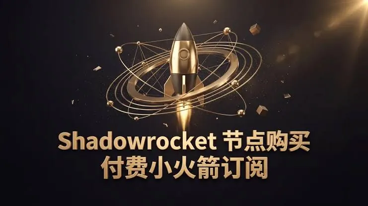
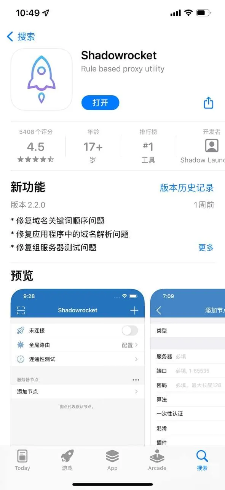

很多用手机Shadowrocket（小火箭）的朋友，换了电脑后总想接着用。搜索「小火煎电脑版」时，发现结果五花八门，有的说能装，有的说不能。其实这里有个关键点：Shadowrocket本身是iOS平台的应用，官方并没有发布Windows或macOS原生客户端。但这不代表电脑上完全没法用，只是需要换条路走。

## 小火煎（Shadowrocket）到底有没有电脑版

Shadowrocket在App Store里的正式版本，只面向iPhone和iPad。打开Mac App Store搜索，是找不到它的。也就是说，**官方电脑版目前并不存在**。很多人搜「小火煎电脑版」，其实是想问：手机上那个小火箭，怎么在电脑上继续用？

这里需要区分两种需求：
- 想在电脑上管理同样的节点、订阅，继续用同一套配置
- 想在电脑上实现类似小火箭的代理功能

第一种需求可以通过同步配置实现，第二种则需要借助其他软件。两种都不需要等待官方出电脑版。

## 电脑上使用小火煎的几种常见方式

既然没有原生客户端，目前能实现「小火煎电脑版」效果的方式主要有这几种。

### 方式一：Mac用户借助Apple Silicon运行iOS应用

如果你用的是搭载M系列芯片的Mac，系统版本在macOS 12.3以上，可以在App Store里直接下载iOS应用。部分用户反馈，Shadowrocket可以这样安装到Mac上，但前提是：
- 你的Mac和iPhone登录的是同一个Apple ID
- 该应用在App Store中仍支持当前系统版本
- 部分功能可能无法完全适配鼠标键盘操作

这种方式属于「能用但不算完美」，适合轻度使用。需要注意，如果应用在App Store下架或不再支持新系统，这种方法就失效了。

### 方式二：用其他代理客户端替代

如果不想折腾iOS模拟器，直接用电脑端的代理客户端更省事。常见的替代方案包括：
- **Clash系列**（Clash Verge、ClashX等）
- **v2rayN**
- **sing-box**

这些软件都支持导入小火箭的订阅链接或节点配置。你只需要把手机上小火箭的订阅地址复制到这些客户端里，就能在电脑上使用同一套节点。配置迁移成本很低，不需要重新购买或注册。

### 方式三：通过路由器或软路由共享

如果你家里有软路由（比如OpenWrt、iStoreOS），可以把小火箭的配置导入路由器上的代理插件。这样电脑、手机、电视都能走代理，不需要每台设备单独装客户端。这种方式适合家里设备多的用户，但设置门槛相对较高。

## Windows用户怎么用小火煎

Windows上没有Apple Silicon，无法运行iOS应用，所以「小火煎电脑版」在Windows上只能走替代方案。

最直接的做法是下载Clash Verge或v2rayN，然后把小火箭的订阅链接粘贴进去。操作流程通常是：
1. 在手机上打开小火箭，找到订阅链接或分享二维码
2. 在电脑客户端里选择「从剪贴板导入」或手动粘贴
3. 选择节点，点击连接

需要注意，小火箭的订阅链接格式可能因机场不同而略有差异。如果导入失败，先检查链接是否完整，是否复制了多余字符。部分客户端还支持直接扫描小火箭的二维码，前提是电脑有摄像头。

如果不想用第三方客户端，也可以考虑在Windows上安装Android模拟器，再运行小火箭的安卓版本。不过这种方式性能损耗较大，且小火箭本身没有官方安卓版，只有一些移植版本，稳定性无法保证。

## 使用电脑版小火煎需要注意什么

无论用哪种方式，有几个问题需要提前想清楚。

### 账号与订阅安全

小火箭的订阅链接本质上包含你的节点信息和流量凭证。把它粘贴到电脑客户端里，等于把凭证暴露给了该软件。因此：
- 尽量选择开源、活跃维护的客户端，比如Clash Verge、v2rayN
- 不要使用来路不明的「电脑版小火箭安装包」
- 如果订阅泄露，及时在机场后台重置订阅链接

### 多设备同时使用的影响

很多机场的套餐只允许同时在线1到3个设备。如果你手机和电脑同时用，可能会互相踢下线。使用前最好确认一下你的套餐允许几个设备同时在线。部分机场的规则是「同一时间只允许一个设备」，这种情况下电脑和手机只能二选一。

### 节点选择与延迟

电脑上的客户端通常比手机更耗资源，如果节点延迟高，网页加载会明显变慢。建议在电脑客户端里开启延迟测速，选择延迟较低、丢包率低的节点。如果某个节点在手机上很流畅但电脑上卡顿，可能是客户端配置差异，也可能是节点本身波动，需要多试几个。

### 隐私与系统设置

代理客户端会接管系统网络流量，部分客户端默认开启「系统代理」或「TUN模式」。如果你只是偶尔用，建议用完关闭；如果长期开启，注意检查是否有其他软件异常占用流量。另外，部分电脑客户端会记录日志，如果涉及隐私，记得关闭日志记录或定期清理。

## 最后想说的是

别把「小火煎电脑版」当成一个等待官方出品的填空题。Shadowrocket官方没出电脑客户端，但电脑上需要的那点功能，市面上现成的客户端已经能覆盖。关键在于你手头的设备和日常使用习惯。手机上的小火箭用得顺手，不代表电脑上非得一模一样。换个客户端，导入同样的订阅，体验可能比硬凑一个「电脑版」更舒服。
