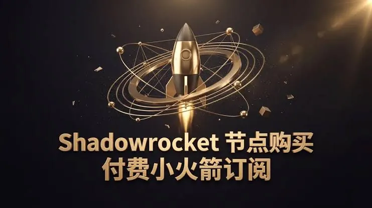
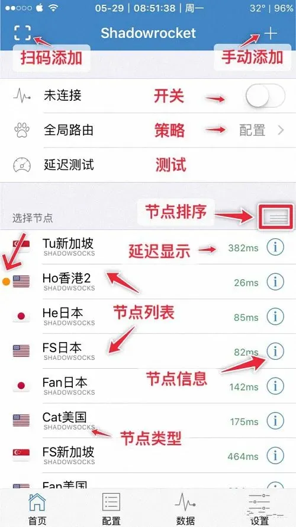

去年底有位读者给我留言，说他花了几块钱买了一个“2026小火箭共享账号”，头两天用着还行，第三天开始频繁掉线，节点列表还在，但就是连不上。他问我是不是自己设置错了。聊到最后发现，问题不在他的配置，而在于他买的那个共享账号本身已经被多人同时登录，触发了苹果账号的安全机制。

这类情况在共享账号用户里并不少见。2026年小火箭共享账号依然有需求，毕竟不是每个人都愿意为一个大几十块的独享账号付费，但共享账号的稳定性、安全性和使用体验，和几年前相比确实有了不少变化。下面围绕实际使用中会遇到的问题，把这件事说清楚。

## 共享账号掉线频繁，问题通常出在哪

小火箭本身是一个网络工具客户端，它依赖的是你登录的 Apple ID 以及这个账号下的购买记录。共享账号的本质，是把一个已经购买过 Shadowrocket 的 Apple ID 提供给多人使用。问题也就从这里开始。

最常见的原因是同时登录设备过多。苹果对同一 Apple ID 的活跃设备数量有约束，当多个陌生设备在短时间内反复登录、退出，系统容易判定为异常行为，表现为要求重新验证、锁账号，或者直接让已登录设备掉线。你这边看到的“小火箭突然不能用了”，很多时候是账号层面被风控，而不是小火箭这个 App 坏了。

第二种情况是账号被频繁切换地区或修改信息。部分共享账号在流转过程中，密码、密保、地区设置被不同的人改动过，账号状态本身就不干净。你拿到手时可能还能登录，但用不了多久就会触发验证。

还有一种容易被忽略：共享账号下的购买凭证被撤销。如果账号来源涉及退款、黑卡或异常交易，苹果可能回收该账号的购买记录，这时候小火箭会从“已购”变成需要重新付费，共享账号自然也就失效了。

**这三种情况有一个共同点：你无法从自己这边彻底解决。** 改 DNS、换节点、重装 App 都作用有限，因为问题在账号，不在客户端。

## 2026年小火箭共享账号为什么比以前更难用

如果把时间拉回几年前，共享账号的可用周期通常更长一些。现在变难，主要有几个现实原因。

一是苹果账号安全策略整体趋严。异地登录、多设备并发、短时间频繁验证，这些行为更容易被识别。共享账号的使用模式天然踩在这条线上，所以被限制的概率比独享账号高很多。

二是共享账号的流转链条更长。一个账号从原始购买者到最终用户手里，可能经过多层转手，中间任何一环改了密码或绑定信息，后面的人都可能被挡在门外。你拿到的账号是不是“一手共享”，很难判断。

三是小火箭这类工具的账号需求本身就在增长，而可用的共享账号供给并没有同步变多。供给紧张时，部分渠道会放宽同时在线人数，或者把同一个账号卖给更多人，直接后果就是互相挤下线。

需要说明的是，这不代表所有共享账号都不能用。仍有部分渠道提供的账号在短期内可以正常登录和使用，但“短期可用”和“长期稳定”是两件事。如果你对连续性要求高，共享账号的天然属性决定了它很难保证这一点。

## 小火箭共享ID和共享账号不是一回事

很多人把这两个概念混着说，实际使用时区别不小。

| 类型 | 本质 | 常见问题 | 适合什么情况 |
| --- | --- | --- | --- |
| 小火箭共享账号 | 已购 Shadowrocket 的 Apple ID，多人共用 | 被挤下线、触发验证、购买记录被回收 | 临时安装、短期试用 |
| 小火箭共享ID | 更广义的 Apple ID 共享，不一定含小火箭购买记录 | 隐私暴露、iCloud 数据混淆、被锁风险 | 不建议用于主力设备 |
| 独享账号 | 仅一人使用的 Apple ID | 成本较高，但状态可控 | 长期稳定使用 |

共享ID的风险比共享账号更广。因为你登录的不只是一个 App 的购买凭证，还可能涉及 iCloud、App Store 的账号体系。如果在 iPhone 设置里直接登录共享ID，通讯录、照片、备份等都可能和陌生人的数据混在一起，退出时如果操作不当，还可能被要求输入原账号密码，导致设备无法正常退出。

相对稳妥的做法是只在 App Store 里登录共享账号下载小火箭，下载完成后退出，不要在系统设置里长期挂着。这样能减少一部分账号关联风险，但并不能解决共享账号本身的稳定性问题。

## 挑选共享账号渠道时要看哪些信息

渠道是否靠谱，直接决定你拿到的是一个能用的账号，还是一个随时会失效的账号。下面几项信息在下单前值得确认。

**账号的购买记录是否完整。** 可以让对方说明账号是否带原始购买凭证，是否支持在 App Store 的已购列表里看到 Shadowrocket。如果对方含糊其辞，或者只愿意给账号密码、不愿意让你先确认已购状态，要多留个心眼。

**同时在线人数有没有说明。** 完全不说人数限制的共享账号，通常意味着卖得很散。人数越多，互相挤下线的概率越高。部分渠道会标注“几人共享”，这个信息可以作为参考，但不要把它当成绝对保证。

**是否提供异常处理方式。** 共享账号出问题是常态，关键看对方是否愿意在你登录不上时更换账号或协助处理。如果售后完全不管，账号一旦失效就等于白买。

**账号来源是否清楚。** 来源不明、价格明显低于常见水平、要求你提供 Apple ID 密码或验证码的，都不建议碰。正规的共享账号交易不需要你交出自己账号的密码，更不会索要短信验证码。

**不要只看“成功率”之类的宣传。** 这类数据很难核实，而且共享账号的可用性受时间、设备、登录人数影响，别人的“成功”不代表你拿到手也顺利。

## 使用共享账号时怎么减少冲突和掉线

即便账号本身没问题，使用方式也会影响能用的时长。下面这些做法不能保证账号不被限制，但能降低一部分人为触发的概率。

- **避免多设备同时登录。** 一个共享账号最好只在一台设备上使用，不要手机和平板同时挂。
- **下载完成后及时退出。** 在 App Store 登录共享账号，下载小火箭，确认能打开后退出账号，不要长期保持登录状态。
- **不要在设置里登录共享ID。** 系统级别的登录会带来更多账号关联和隐私风险，能用 App Store 解决的就不要动设置。
- **不要修改账号的密码、密保或地区。** 你改了，别人就用不了，账号也容易被锁。
- **遇到要求验证时不要反复尝试。** 连续输错密码或频繁触发验证，会让账号更快被限制。可以先联系提供方确认账号状态。
- **不要用共享账号绑定自己的支付方式。** 既无必要，也会增加个人信息暴露的可能。

还有一个常被忽略的点：共享账号登录后，iCloud 同步、备份、查找等功能可能和账号绑定。如果你在系统层面登录过，退出前要确认没有把个人数据留在该账号下。只在 App Store 登录的情况下，这个问题相对小一些，但仍建议下载完就退出。

## 什么情况下应该考虑独享账号

共享账号适合“先装上用一阵”“临时需要”“预算有限”的场景。但如果你属于下面几种情况，继续用共享账号的体验大概率不会好。

一种是每天都要用，且对连接连续性有要求。共享账号被挤下线的时间点不可控，正需要用的时候连不上，很耽误事。

一种是在主力设备上使用。主力机涉及支付、照片、工作资料，账号体系越简单越好，没必要为了省一点成本把设备挂在共享ID上。

还有一种是被共享账号反复折腾过。换了两三个账号还是掉线、验证、失效，说明你遇到的不是个别账号问题，而是共享模式本身的局限。这时候换个思路比继续换账号更实际。

独享账号的成本通常高于共享账号，但账号状态由自己控制，不用和别人抢登录，也不用担心别人改了密码导致自己用不了。购买独享账号时同样要确认来源、购买记录和售后，不是“独享”两个字就代表一定可靠。

2026年小火箭共享账号还能不能用？能用的情况有，但它的定位更适合短期、临时、低连续性需求。把它当成长期稳定方案，失望的概率不小。先想清楚自己属于哪种使用场景，再决定要不要在共享账号上反复投入时间，会比盲目换账号更省事。
