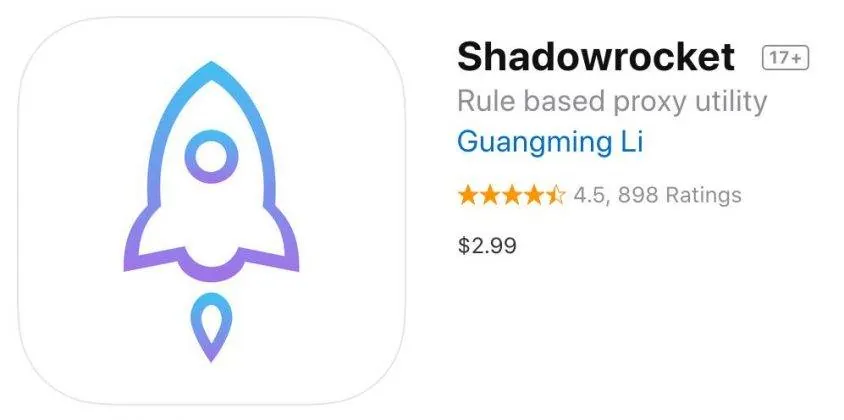
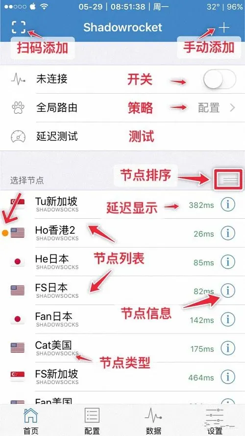

2026年小火箭共享账号依然有不少人在用，但真正用得省心的人并不多。不少人兴冲冲买来一个共享账号，用了没几天就发现连不上、被踢下线，甚至提示密码错误。问题到底出在哪里？2026年的小火箭共享账号和以前有什么不同？这篇文章直接说清楚。

## 2026年小火箭共享账号到底指什么

小火箭是Shadowrocket的中文俗称，本质是一个iOS端的代理客户端工具。它本身不提供任何节点服务，只是一个壳。你打开小火箭，看到里面空空如也，需要自己添加服务器配置才能使用。

而“小火箭共享账号”这个词，在不同场景下有两层含义：

第一层是指共享Apple ID。小火箭是付费软件，在App Store上架时售价通常是2.99美元左右。有人不想单独付费，就使用别人提供的共享Apple ID登录App Store，下载小火箭App。这种情况下，你用的其实是同一个Apple ID下载的同一个App。

第二层是指共享订阅配置。有人购买了一台服务器或者一个节点套餐，然后把配置链接（类似`ss://`、`vmess://`、`trojan://`这样的链接）分发给多个人使用。大家共用同一套节点，只是客户端各自独立。

2026年最新小火箭共享账号，更多指向后者——共享节点配置。因为苹果对共享Apple ID的管控越来越严，很多人已经转向共享配置的方式。但无论哪种，都逃不开稳定性问题。

## 小火箭共享账号为什么总是掉线

这是使用共享账号的人最常问的问题。掉线的原因通常集中在几个方面：

**同时在线人数过多。** 一个节点带宽有限，如果10个人同时用，速度自然被摊薄。高峰期卡顿、延迟飙升，甚至直接连不上。共享账号一般不会限制同时在线人数，卖家也不管，你连上了，别人也连上了，谁也抢不过谁。

**节点被频繁检测和封锁。** 2026年网络环境复杂，很多节点IP会被持续监测。共享账号的节点因为使用人数多，流量特征明显，更容易被识别和阻断。独享账号同样可能被封，但概率相对低一些。

**配置链接过期或失效。** 很多共享账号的配置是卖家批量生成的，有效期可能只有一个月甚至更短。到期之后你没收到通知，还以为账号坏了，实际上是配置本身已经失效。

**设备指纹冲突。** 如果你使用的是共享Apple ID方式，苹果设备之间会同步一些状态信息。多台设备用同一个Apple ID登录，经常出现相互踢下线的情况。特别是你开了iCloud同步，另一台设备操作一下，这边就被顶掉了。

**客户端版本不匹配。** 小火箭更新比较频繁，旧版本客户端对某些新协议的支持有限。共享账号如果使用了较新的协议类型，而你的客户端版本太老，连接就会异常。

所以，如果你正在用共享账号并且频繁掉线，先别急着怀疑账号被卖家骗了，按照上面几个方向排查一下，往往能找到原因。

## 2026年选择小火箭共享账号要确认哪些信息

如果你还是想用共享账号，购买之前务必确认下面这些信息。这些信息直接决定了你能不能稳定使用。

**账号类型是Apple ID共享还是配置共享。** 这是两回事。Apple ID共享需要你登录App Store，下载App后退出，不要登录iCloud。配置共享则是把节点链接导入小火箭，不需要动Apple ID。2026年后者更安全，因为不涉及账号密码，不会泄露你的Apple ID。

**同时在线人数限制是多少。** 靠谱的卖家会在商品说明里写明“支持几台设备同时在线”。如果写的是“无限”，那基本可以判断这个节点会被挤爆。正常情况下，一个节点同时在线2-3人以内比较流畅，超过5人就开始明显卡顿。

**节点有效期有多长。** 共享账号通常有使用期限，7天、15天、30天不等。购买前问清楚，如果卖家含糊其辞，只说“长期有效”，大概率是随时可能失效的。

**节点覆盖哪些地区。** 不同地区节点的速度和稳定性差别很大。香港、日本、新加坡这类线路通常比较稳，美国西海岸也还可以。如果是冷门地区，延迟可能很高，使用体验会很差。

**是否支持更换节点。** 共享账号最大的问题之一就是节点挂了之后没得换。有些卖家提供节点更换服务，挂了之后可以联系更换。有些则是一锤子买卖，节点死了就只能自认倒霉。这个必须提前问清楚。

**售后怎么处理。** 2026年的小火箭共享账号市场鱼龙混杂，有售后和没售后完全是两个体验。正常卖家会提供一定期限的售后，比如24小时内节点失效可以免费更换。购买前确认好售后规则，别等出了问题才去扯皮。

## 小火箭共享账号和独享账号怎么选

很多人纠结这个问题，其实答案很简单：看你的使用频率和需求。

**共享账号适合谁：** 偶尔用一下、对速度不敏感、不想花太多钱、能接受掉线后自己手动重连的人。比如你一个月就用几次，看看网页、收收邮件，共享账号完全够用。价格便宜，坏了也不心疼。

**独享账号适合谁：** 每天都要用、需要稳定连接、从事视频会议或远程办公、对延迟和速度有要求的人。独享账号意味着这个节点只有你一个人用，带宽不被别人分摊，稳定性有保障。价格自然高一些，但算下来每天的成本其实并不高。

还有一种折中方案：买一个小型的独享套餐，比如只支持1-2台设备同时在线，价格比纯独享便宜，又比共享稳定。2026年很多服务商都提供这种方案，适合两个人拼单使用。

**不要只看价格。** 共享账号价格低，但如果你因为掉线频繁而反复购买，累计花费反而超过一个稳定的独享账号。这个账很多人算不明白。

## 小火箭共享ID使用时需要注意什么

如果你选择的是共享Apple ID方式，下面这些注意事项一定要看。这部分风险最高，也最容易被忽略。

**绝对不要登录iCloud。** 共享Apple ID只用于App Store下载小火箭。下载完成后，退出App Store登录即可。千万不要在设置里登录iCloud，否则你的通讯录、照片、备忘录都可能同步到别人的设备上，隐私风险极大。

**关闭自动下载和自动更新。** 如果你用共享ID下载了小火箭，记得在App Store设置里关闭“自动更新”和“蜂窝网络自动下载”。否则系统可能在后台自动更新App，导致账号冲突或验证失败。

**不要使用共享ID购买其他App。** 共享ID的支付方式通常是绑定的，你用它买App，钱可能会从别人的账户扣，也可能导致账号被锁定。

**修改密码要谨慎。** 有些共享ID卖家会告诉你“可以修改密码”，但如果你改了，其他使用这个ID的人就登录不了了，可能会引发纠纷。而且共享ID的密码修改后，Apple可能会触发安全验证，需要验证原绑定手机号，你大概率没有这个权限。

**定期检查设备管理。** 在Apple ID的“设备”列表里，看看有没有不认识的设备。如果有，说明你的账号被其他人登录了，尽快移除不认识的设备。

**共享ID被封的风险。** 2026年苹果对共享ID的打击力度明显加大。如果某个ID被多人使用、下载量异常，苹果会直接锁定该ID。一旦锁定，你可能连App都打不开。所以使用共享ID之前，要有这个心理准备。

## 怎么判断2026年小火箭共享账号靠不靠谱

判断一个共享账号是否靠谱，可以从几个维度看：

**看节点质量。** 购买前要求卖家提供测试链接，你自己导入小火箭试一下。能连接、速度稳定、延迟不高的，才有购买价值。如果测试都连不上，直接放弃。

**看卖家态度。** 靠谱的卖家会主动告知你节点的有效期、在线人数限制、售后规则。如果卖家只催你付款，问什么都是“放心用”，大概率有问题。

**看价格是否合理。** 2026年小火箭共享账号的价格差异很大，从几块钱到几十块钱都有。价格过低（比如1块钱包月）基本不靠谱，要么是节点质量极差，要么是跑路的。价格过高（比如超过独享账号价格）也没必要选共享。

**看更新频率。** 如果卖家的节点能持续更新，说明他背后有稳定的资源。如果节点更新很慢，或者你问起来才说“马上更新”，说明资源不稳定。

**看用户反馈。** 如果有评价渠道，看看其他用户怎么说。注意区分真实评价和刷的评价。刷的评价通常措辞一致、时间集中、内容空洞。

## 使用小火箭共享账号的常见错误

最后说几个大家容易犯的错误，这些错误会让共享账号的使用体验雪上加霜。

**错误一：多台设备同时使用。** 共享账号本来就容易掉线，你还要手机、平板、电脑同时连，带宽被进一步分摊，掉线概率更高。尽量只在一台设备上使用。

**错误二：不更新配置。** 共享账号的配置链接是有有效期的，很多人导入一次就不管了。节点失效后，应该联系卖家获取最新配置，而不是反复重试旧链接。

**错误三：开启全局路由。** 小火箭有“配置”和“全局路由”选项，全局路由意味着所有流量都走代理，包括系统更新、App下载等大流量请求。共享账号带宽有限，开启全局路由会迅速消耗流量，导致节点被限速。建议使用“配置”模式，只代理需要代理的App。

**错误四：忽视客户端版本。** 小火箭需要定期更新，新版本对协议支持更完善。如果客户端太老，某些新协议无法解析，连接就会失败。2026年建议使用最新版本的小火箭。

**错误五：不保留备用方案。** 共享账号随时可能失效，最好准备一个备用的独享账号或者备用节点，避免关键时刻掉链子。

## 写在最后

2026年的小火箭共享账号依然有它的价值，但前提是你要清楚它适合什么场景、有什么限制。如果你是偶尔使用、预算有限，共享账号是一个合理的选择；如果你追求稳定、每天都要用，更建议选择独享账号或者小型套餐。

不管选哪种，都要在购买前确认好节点有效期、在线人数限制和售后规则。使用过程中注意保护隐私，特别是共享Apple ID方式，千万不要登录iCloud。

希望这篇文章能帮你少走一些弯路。如果你现在正在用共享账号，遇到掉线问题，先按照上面的思路排查一遍，多数情况下都能找到原因。
