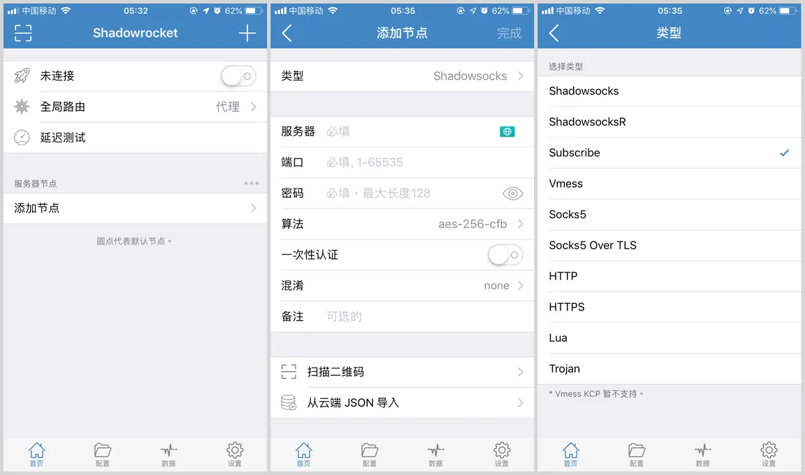
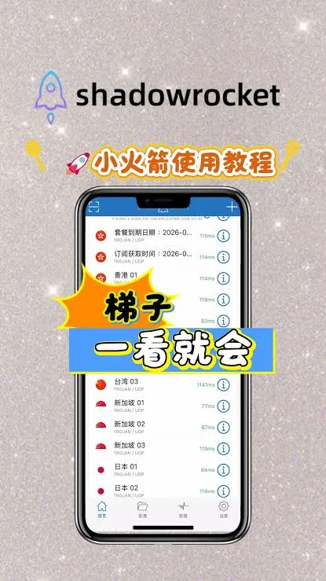

换了新手机想把旧账号登回来，或者坐在电脑前想看看自己账号下绑了哪些设备，很多人第一反应是打开搜索引擎找“appleid登录入口”，结果点进一堆长得像苹果官网的页面，输完密码才发现不对劲。这个入口其实一直就那一个官方地址，只是不同设备上进入的位置不太一样。下面按你实际会遇到的几种情况分开说清楚。

## 网页上登录 Apple ID，地址只有 appleid.apple.com

这是苹果官方的账号管理页面，在浏览器地址栏直接输入 `appleid.apple.com` 就能打开。注意是 appleid 加上 apple.com，中间没有横杠、没有多余字母，也不带任何后缀数字。搜索结果里排在前面的推广位、第三方“快捷登录”页面，和这个地址无关。

登录进去之后能做这些事：

- 查看和修改姓名、生日、地区、绑定的手机号和备用邮箱
- 改密码、管理双重认证和受信任设备
- 看当前有哪些设备登录着这个账号，并把不用的设备移除
- 管理付款方式、订阅项目和购买记录

如果只是想用 iCloud 的网页版功能，比如查看照片、备忘录、通讯录，入口是 `icloud.com`，登录时同样用 Apple ID 和密码，但页面功能偏应用，不做账号设置管理。两个入口容易混，需要改账号信息就走 appleid，需要看云端内容就走 iCloud。

网页端登录通常要过双重认证：输完密码，受信任的设备上会弹出一个六位数验证码，填进去才进得去。收不到验证码的情况后面单独说。

## iPhone 和 iPad 上的入口在“设置”最上面

打开“设置”，页面顶部就是你的头像和名字，没登录过的话这里显示“登录你的 iPhone”或“登录你的 iPad”。点进去输入 Apple ID 和密码即可。这条路径是设备的主账号入口，登录后会影响 iCloud 备份、查找、App Store、iMessage 等一整套服务。

还有两个常被混淆的入口：

**App Store 里的账号入口**。打开 App Store，点右上角头像，可以单独登录一个“媒体与购买项目”账号。这个账号只决定你在商店里买东西用哪个身份，和设置顶部的设备主账号可以是两个不同的 Apple ID。有些人一部手机上主账号是家人的，App Store 用自己的，就是通过这里分开的。

**“设置”里的 iCloud 入口**。较新的系统版本里，iCloud 相关设置已经合并进顶部的 Apple 账户页面，不再单独出现一个“iCloud”登录框。看到旧教程让你在设置里找 iCloud 图标登录，那是老版本系统的路径。

## Mac 和 Windows 电脑上的位置不太一样

Mac 上打开“系统设置”，左上角或侧栏顶部有“Apple 账户”，点击后登录。旧版本 macOS 里这个位置叫“系统偏好设置 → Apple ID”，本质是同一个东西。

Windows 电脑没有系统级的 Apple ID 入口，需要用苹果提供的应用：

- 装了 iCloud for Windows，可以在应用里登录，同步照片、文件、密码等
- 装了 iTunes，在“账户”菜单里登录，用于购买和授权

在这两个应用里登录的是同一个 Apple ID，但各自管理的内容不同。Windows 上登录状态出问题，多数是应用版本过旧或系统时间不准导致的验证失败。

## 登录时卡住、验证码收不到，先查这几项

网页或设备上输入账号密码后一直转圈、提示“无法登录”，或者双重认证的验证码迟迟不来，按顺序排查通常能定位到原因：

1. **设备日期和时间**。系统时间偏差过大会让验证请求被判为异常。把时间设为自动获取。
2. **网络环境**。部分公司网络、校园网会对苹果的验证服务做限制，换一个网络试试，比如手机热点。
3. **受信任设备不在身边**。双重认证的验证码只发到已信任的设备或信任的手机号。旧手机卖了、号码换了，就收不到。这种情况需要用账号恢复流程，在登录页面点“忘记密码”或“无法使用你的 Apple ID”按提示走，可能要等一段时间审核。
4. **账号被锁定**。多次输错密码、或者在陌生地点频繁登录，账号可能进入保护状态。页面上一般会给出解锁提示，跟着走就行，不要去找所谓的“解封服务”。
5. **浏览器问题**。清一下缓存，或用无痕窗口重新打开 appleid 页面，插件拦截脚本也会导致按钮点不动。

有一点要提醒：登录入口页面不会主动向你要验证码转发给别人，也不会让你下载描述文件或安装“安全插件”。凡是登录过程中跳出这类要求的，基本可以判定不是官方流程。

## 在设备上登录别人的 Apple ID，退出时可能很麻烦

这是登录入口相关问得最多的隐性问题。有人图方便，在自己 iPhone 的设置顶部登录了朋友或卖家提供的 Apple ID，用来下载某个应用。登进去容易，退出来未必顺利：

- 开启“查找”后，设备会和该账号绑定，退出时必须输入那个账号的密码，否则设备可能被 Activation Lock 锁住
- 账号的照片、通讯录、备忘录会同步到设备上，双方的数据混在一起
- 对方在网页端能看到你这台设备出现在他的设备列表里，也能远程移除

如果只是想下载 App，正确做法是在 App Store 里单独登录媒体与购买项目账号，用完退出，不要动设置顶部的设备主账号。任何情况下都不要把自己的密码、验证码交给别人代登录。

## 找回密码的入口和登录入口不是同一个

登录页面下方通常有“忘记密码？”链接，会跳到账号恢复流程，地址是 `iforgot.apple.com`。这条流程里要验证手机号、备用邮箱或者回答安全问题，通过后重设密码。它和 appleid 管理页面是两个不同用途的入口，一个是改资料，一个是找回访问权限。

账号恢复有时需要等待，苹果会在页面上显示预计时间，这段时间内反复提交申请不会加快进度，反而可能延长。等待期间可以先确认备用邮箱是否还能收信、绑定的手机号是否还在用。

## 几个容易记混的小问题

**登录入口需不需要每次记网址？** 常用的话收藏 appleid 页面就够了。在 iPhone 上也可以通过“设置 → Apple 账户”进入，不必开浏览器。

**一个邮箱能不能注册多个 Apple ID？** 通常不能，同一个邮箱只能作为一个账号的登录名。但一个 Apple ID 可以绑定多个备用邮箱和手机号。

**退出登录会不会丢数据？** 退出设备主账号时，系统会问是否在设备上保留 iCloud 数据的副本。选择保留，照片通讯录等会留在本机；选择删除，本地也会清掉，之后再用同一账号登录可以同步回来，前提是数据已经上传过。

**网页端登录后关掉浏览器，设备上会不会被踢下线？** 不会。网页登录是独立会话，和设备上的登录状态互不影响，除非你在设备列表里手动移除某台设备。

找到正确的 appleid 登录入口只是第一步，真正省事的是把双重认证的受信任设备和备用联系方式维护好。换号码、换手机之后抽空去 appleid 页面更新一下，下次需要登录或找回密码时才不至于卡在验证环节。
