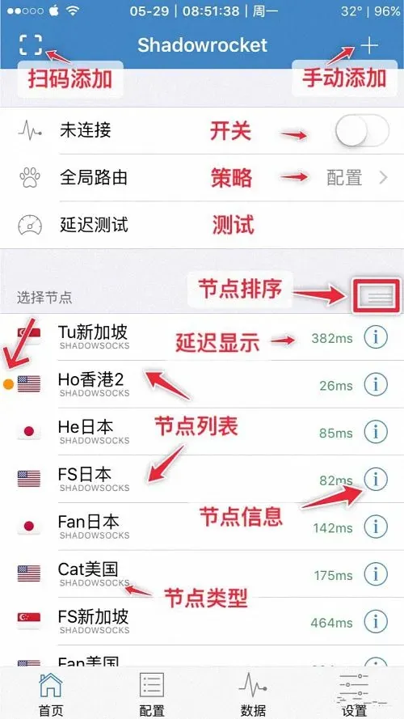

当你在使用 iPhone、iPad、Mac 或 Windows 电脑时，发现 Apple ID 无法连接服务器，无法登录 iCloud、App Store、iTunes 或其他 Apple 服务，这种情况会直接影响日常使用和数据同步。下面从常见原因、网络检查、账号本身、设备与地区差异以及进阶解决方案几个方面，系统性地帮助你快速定位并恢复正常连接。

## appleid无法连接服务器的常见原因

appleid无法连接服务器的根本原因通常可以归纳为以下几类：

1. **网络异常**：本地 Wi‑Fi、移动数据或路由器设置不当，导致无法到达 Apple 官方服务器的 IP 地址或端口。  
2. **Apple 服务器维护或故障**：Apple 临时进行的服务器升级、网络拥堵或地区性故障会导致全球或特定地区的连接中断。  
3. **账号安全限制**：Apple 为防止异常登录行为，可能暂时封锁或限制某些设备的登录，尤其是长时间未使用或多设备登录的账号。  
4. **系统或应用版本过旧**：旧版 iOS、macOS 或相关应用的协议兼容性不足，也会出现连接失败。  
5. **代理、VPN 或防火墙干找**：使用不当的代理或 VPN 可能导致请求被阻断，尤其是对 Apple ID 的特定端口（如 443、80、5223 等）受限。

了解这些原因后，你可以针对性地进行检查，而不是盲目重启设备。

## 网络设置检查与基础故障排除

### 确认本地网络可达性

- 打开浏览器，访问 **apple.com** 或 **icloud.com**，确认页面能正常加载。若无法打开，说明网络本身存在问题。  
- 使用 `ping` 或 `tracert`（Windows）/ `traceroute`（macOS/Linux）命令测试对 Apple 服务器的连通性，例如 `ping www.apple.com`。若出现超时或不可达，则需检查路由器、DNS 设置或更换网络环境（如使用手机热点）。

### 重置网络配置

- 在 iOS 设备上，进入 **设置 > 通用 > 重置**，选择 **重置网络设置**，系统会重新配置所有网络相关设置。  
- 在 macOS 上，打开 **系统设置 > 网络**，删除当前网络后重新连接，或点击 **高级 > DNS**，将 DNS 设置改为 **8.8.8.8**（Google DNS）或 **1.1.1.1**（Cloudflare DNS），再保存重启。

### 检查代理与 VPN

- 关闭所有代理设置：iOS **设置 > 通用 >  VPN**，确保没有激活的 VPN；macOS **系统设置 > 网络 > 代理**，确认未勾选任何代理选项。  
- 若使用企业或学校网络，可能需要联系网络管理员解除对 Apple 端口的限制。

## Apple ID 账号本身的登录与验证问题

### 检查 Apple ID 状态

- 访问 **appleid.apple.com**，使用已有的 Apple ID 与密码登录。若出现 **“您的 Apple ID 在使用中”** 或 **“此账号已被暂停”** 的提示，说明账号可能受到安全限制。此时建议在另一台设备上登录，或等待数小时后再尝试。

### 重新输入密码并开启双重验证

- 若密码输入错误多次，系统会暂时锁定登录。此时可以点击 **“忘记 Apple ID 或密码”**，按照提示重置密码。  
- 开启 **双重验证**（2FA）后，登录时会要求输入验证码，这有助于验证账号真实性，也能降低因可疑登录被封锁的风险。

### 清除缓存与重新登录

- 在 iPhone 或 iPad 上，进入 **设置 > [你的名字] > 登录出去**，然后重新输入 Apple ID 与密码进行登录。  
- 在 macOS 上，打开 **系统设置 > Apple ID**，点击 **登录出去**，再重新登录。

## 使用不同设备或地区时的兼容性与限制

### 设备兼容性

- 某些旧款设备（如 iPhone 5s 及更早）可能不支持最新的 Apple ID 认证协议，导致连接失败。此时建议更新系统到支持的最新版本，或在其他较新设备上完成登录后再同步。

### 地区与服务限制

- Apple ID 的某些功能（如 iMessage、FaceTime）在特定地区可能受限。若你在使用 VPN 或代理切换地区，需要确认该地区的服务是否已开放，否则会出现连接异常。

## 进阶解决方案：重置、重新激活与官方支持

### 重置 Apple ID 相关缓存

- 在 iOS 设备上，进入 **设置 > 通用 > 存储与 iCloud 使用情况 > 管理存储空间**，清除不必要的缓存文件。  
- 在 macOS 上，打开 **Finder**，前往 **~/Library/Caches**，删除与 Apple ID 相关的缓存文件（如 `com.apple.account`），然后重启电脑。

### 重新激活 Apple ID

- 访问 **appleid.apple.com**，在 **安全设置** 中选择 **重新激活**，系统会重新验证账号。此过程通常需要验证手机号或备份邮箱，确保账号安全。

### 联系 Apple 官方支持

- 如果以上步骤均未解决，建议通过 **Apple 支持**（support.apple.com）提交工单，或拨打当地 Apple 客服热线。提供以下信息会更有效：设备型号、系统版本、出现问题的具体时间点、已尝试的排查步骤。

## 常见问题简述（FAQ）

**Q1：appleid无法连接服务器是否与网络运营商有关？**  
A：是的，部分运营商在特定时段会限制国际 DNS 或端口，导致连接失败。可以尝试切换到其他网络或使用 VPN（需确保 VPN 不影响 Apple 服务）。

**Q2：重置 Apple ID 会丢失数据吗？**  
A：重置本身不会删除 iCloud 内容，但若账号被封锁或需要重新验证，可能暂时无法同步。建议在重置前先确保重要数据已备份。

**Q3：使用共享 Apple ID 会导致连接问题吗？**  
A：共享账号因同时在多设备登录，容易触发安全限制，出现连接异常的情况更常见。若可能，建议使用独立的独享账号。

**Q4：如何知道是否被 Apple 服务器限制？**  
A：在 **appleid.apple.com** 的 **安全** 页面可以查看最近的登录记录，若出现陌生 IP 或多次登录失败的提示，则可能被限制。

通过以上系统化的检查与解决步骤，大多数 appleid无法连接服务器的问题都能得到快速修复。若仍未解决，及时联系 Apple 官方渠道是最可靠的途径，确保账号安全与服务连通。祝你使用顺畅！
