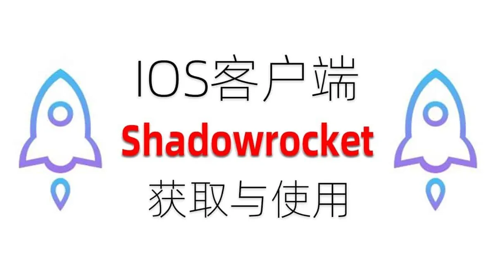

不少人为了在手机或平板上使用某些特定应用、下载地区限制的内容，会接触到AppleID账号共享这个说法。它听起来很方便，但实际用起来情况可能比想象中复杂。这篇文章从真实使用角度出发，把共享账号的几种形式、常见问题、安全风险以及实际选择建议讲清楚。

## 为什么有人会选择AppleID账号共享

共享AppleID的需求通常不是凭空产生的，背后往往对应着几个很具体的场景。

**跨区下载应用**是最常见的动机。很多应用只在特定地区的App Store上架，比如有些工具类应用只在美区或港区提供。如果用户自己的账号不在那个地区，就无法直接下载。共享一个已经注册好的对应地区AppleID，就能绕过这个限制，登录后直接获取需要的应用。

**节省购买成本**也是重要原因。一些付费应用或内购项目价格不低，多人分摊使用一个账号，平均下来每个人的成本会低很多。尤其是家庭内部或者关系密切的朋友之间，这种分摊方式很常见。

**临时使用需求**同样不少。有些人只是偶尔需要某个应用，不想为此专门注册一个账号或购买，就会找共享账号临时用一下。用完退出，下次需要时再登录。

这几个场景决定了共享账号的使用者往往不是同一个人，也带来了后续的一系列问题。

## AppleID账号共享的几种常见形式

共享AppleID并不是只有一种模式，实际使用中主要分为三类，它们的风险和体验差异很大。

**Apple官方家庭共享**是相对安全的一种形式。这是苹果官方提供的功能，通过家庭组把最多六个人组织在一起，共享购买的应用、音乐、照片等内容。每个成员保留自己的AppleID，只是共享购买记录和部分内容。这种形式下，个人账号是独立的，不会出现互相干扰的情况，但需要组建家庭组才能实现。

**直接共享同一账号**是另一种常见形式。多人使用同一个AppleID，登录各自的设备。这种形式最灵活，但也最脆弱。任何一个人修改密码、开启双重验证或者进行某些安全操作，都会影响到所有使用者。多台设备同时在线时，还可能触发苹果的安全机制，导致账号被临时锁定。

**第三方提供的共享账号**是第三种形式。这类账号通常由专门的人或组织注册、维护，然后提供给付费用户使用。账号可能被很多人同时使用，稳定性完全取决于维护者的管理水平。这类账号的风险也最高，因为使用者无法确认账号来源，也无法控制账号的使用情况。

## AppleID共享账号容易出现哪些问题

共享账号用得多了，各种问题就会暴露出来。根据使用者的普遍反馈，最常见的有下面几类。

**频繁掉线和被踢出**是最让人头疼的问题。当多人同时使用一个账号时，苹果的系统可能会检测到异常登录行为，主动要求验证。或者其中一个人进行某些操作，导致其他设备上的登录状态被强制退出。使用者不得不反复登录，体验很差。

**账号被锁定或封禁**也时有发生。如果共享账号被多人异地登录，或者被系统判定为异常使用，账号可能被临时锁定，甚至永久封禁。一旦账号被封，所有使用者的访问都会中断，而且很难恢复。

**隐私泄露风险**往往被低估。很多人使用共享账号时，会在设备上保存密码或开启自动登录。如果共享账号的维护者能看到登录设备的列表，或者账号被其他人恶意使用，个人数据就可能暴露。更严重的是，如果共享账号关联了支付信息，风险会进一步放大。

**设备冲突**也是常见问题。比如同一个账号在手机上登录了iCloud，又在平板上登录了App Store，两边可能会产生同步冲突。或者一台设备上的下载任务被另一台设备上的操作打断，导致应用无法正常更新。

## 使用AppleID共享账号要注意什么

如果确实需要用到共享账号，一些操作上的注意事项能明显降低风险。

**登录前先确认账号来源**。如果是第三方提供的账号，尽量选择有口碑、能提供售后支持的地方。不要随便在群里看到有人发账号就拿来用，这类账号可能已经被多人使用过，随时可能失效。

**不要登录iCloud**。共享账号只用于App Store或特定应用的登录，尽量不要把它用作iCloud账号。iCloud涉及照片、通讯录、备忘录等个人数据，一旦同步到共享账号，隐私就无法保证了。正确做法是在App Store里登录共享账号，其他功能保持自己的账号。

**避免同时在线**。如果知道账号还有其他使用者，尽量错开使用时间。比如白天使用的人多，可以换到深夜或清晨使用。同时在线人数越多，触发安全验证的概率就越高。

**使用后及时退出**。用完共享账号后，退出登录并清除保存的密码。这样即使账号在其他设备上出了问题，也不会直接影响到自己的设备。尤其是在公共设备上使用时，这一步不能省略。

**开启双重验证**。如果账号权限允许，开启双重验证能增加一层保护。但要注意，双重验证的验证码会发送到账号绑定的设备或手机上，如果共享账号绑定的手机不在自己手里，验证码就无法获取，反而会导致登录困难。所以这个操作需要根据账号的具体情况来判断。

## 独享账号和共享账号怎么选

很多人会在独享账号和共享账号之间犹豫，两者的区别其实很明显。

| 对比维度 | 独享账号 | 共享账号 |
|---------|---------|---------|
| 使用稳定性 | 高，只有自己使用 | 低，受其他使用者影响 |
| 安全性 | 高，账号由自己控制 | 低，来源和使用者不明 |
| 成本 | 较高 | 较低或免费 |
| 隐私保护 | 完全由自己掌控 | 存在泄露风险 |
| 适用场景 | 长期、频繁使用 | 临时、低频使用 |

**独享账号**适合长期频繁使用的人。如果某个应用需要天天用，或者涉及个人数据，独享账号是更稳妥的选择。虽然成本高一些，但省去了反复登录、担心掉线的麻烦。

**共享账号**适合临时使用或低频使用的人。如果只是偶尔用一次，或者为了下载某个应用后就不再需要，共享账号能节省成本。但使用时要做好随时出问题的心理准备。

如果使用频率中等，还有一种折中办法：找一个可靠的渠道购买独享账号，但选择价格较低的套餐。这样既保留了账号的控制权，又降低了成本。不过具体价格和渠道需要根据实际情况判断，无法给出确切数字。

## AppleID账号共享相关的常见疑问

**共享账号会不会导致自己的设备被远程锁定？**
有可能。如果共享账号的维护者开启了丢失模式或进行某些安全操作，登录过该账号的设备可能被影响。所以尽量不要在主力设备上长期登录共享账号，用完后及时退出。

**共享账号被封了，里面的应用还能用吗？**
通常不能。应用的使用权限和账号绑定，账号被封后，已下载的应用可能无法继续更新，部分应用甚至无法正常打开。已购买的内容也会随账号失效而无法使用。

**家庭共享和共享账号有什么区别？**
家庭共享是苹果官方功能，每个成员有独立账号，只是共享购买内容，安全性高。共享账号则是多人直接使用同一个账号，所有操作互相影响，风险更高。家庭共享需要组建家庭组，适合家人之间使用；共享账号适合临时或低频使用场景。

**怎么判断一个共享账号靠不靠谱？**
可以看维护者是否提供使用说明、是否支持问题反馈、是否明确说明同时在线人数限制。如果对方什么都不说，只说账号密码，那就要多留个心眼了。另外，观察账号的使用时间长短也有参考价值，用了很久还在正常维护的账号，通常比刚出现就消失的账号更可靠。
