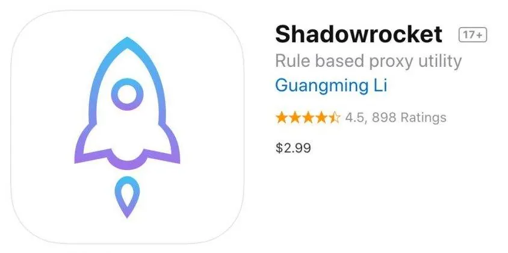
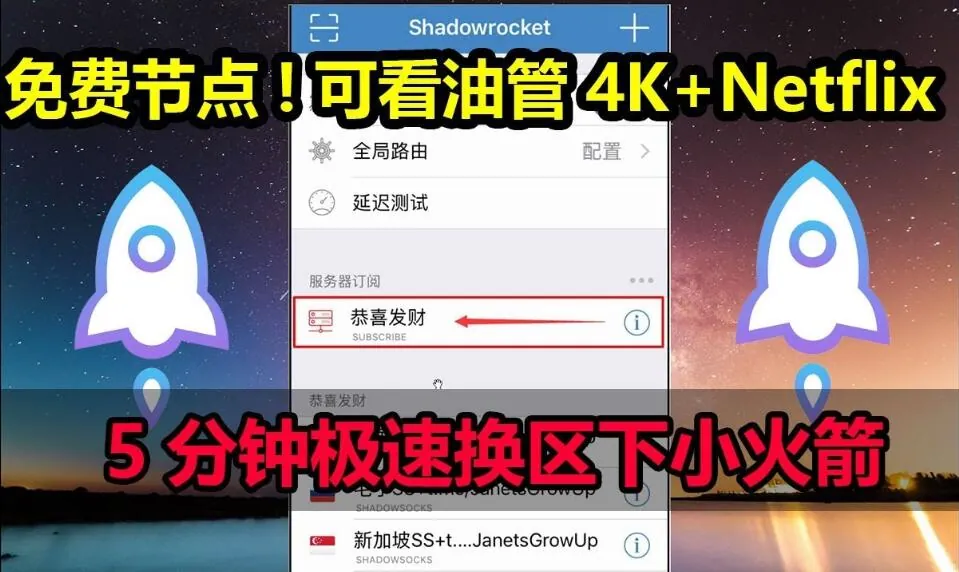
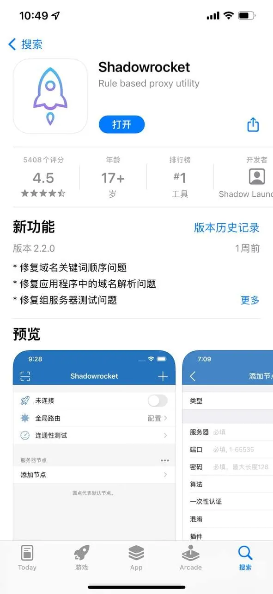

一个挺常见的场景：换了新手机，登录自己的 Apple ID，打开 AppleStore 想装回原来常用的几个应用，结果搜索框里输入名字，出来的全是无关结果，个别应用点进去还提示“此项目在你所在地区不可用”。第一反应往往是手机坏了、系统出问题了，实际上手机大概率没事，问题出在账号和商店本身的匹配关系上。

中文语境里说 AppleStore，指向其实有两种：一种是商场里的苹果零售店和官网商城，另一种是手机、平板上的 App Store 应用商店。搜这个词的人，绝大多数遇到的是后者的使用问题——下载不了、搜不到、切换不了地区、充值不成功。下面按实际会碰到的顺序讲。

## 先确认你说的AppleStore是哪一个

这两个东西名字像，处理方式完全不同。

线下零售店和官网商城，解决的是购买硬件、预约维修、以旧换新这类需求，出问题一般是订单、发货、保修。手机上的 App Store，解决的是下载应用、内购、订阅，出问题基本围绕账号地区、支付方式、网络环境。

两者的账号体系是同一套 Apple ID，但**媒体与购买项目**和 **iCloud** 是分开的两块。这个区别后面还会用到，先记住：前者管商店消费，后者管照片、通讯录、备份。混在一起登录，容易出麻烦。

## AppleStore加载不出来，先排除这几个原因

页面一直转圈、白屏，或者干脆提示“无法连接到 App Store”，先别急着重装系统。

**网络解析问题**。App Store 的页面请求对 DNS 比较敏感，某些公共 DNS 或者运营商 DNS 解析异常时，就会出现能上网但商店打不开的情况。切换一下 Wi-Fi 和蜂窝数据，看是否只在某一个网络下出现，这一步能快速定位。

**系统时间和日期**。听起来不相关，但设备时间偏差过大时，HTTPS 证书校验会失败，商店的请求就会被拦下来。把“自动设置”打开即可。

**账号需要重新验证**。长时间没登录，或者在其他设备上改过密码，系统会要求重新输入密码甚至验证码，界面表现就像卡在加载。去设置里看一下账号那一栏有没有红色提示。

还有一种情况是商店本身在维护，或者某个地区的服务临时异常，这种只能等，跟你设备没关系。判断方法是换一台设备、换一个网络试同一个账号，如果都一样，基本可以确定不是本机问题。

## 应用搜不到，多半是账号地区在起作用

App Store 的内容库是按国家/地区划分的，同一个应用名，在不同地区的商店里可能上架状态不同、版本不同，甚至压根没有。搜索时出现“没有结果”或者结果里全是同名但不相关的应用，通常就是当前账号所属地区和你想找的内容不匹配。

查看当前地区的方法大致是这样：设置 → 顶部你的名字 → 媒体与购买项目 → 查看账户，页面里会显示国家/地区。不同系统版本菜单文字略有差别，但路径差不多。

这里有个容易误解的点：**商店地区跟着账号走，不跟着手机语言走**。把系统语言改成英文，商店内容不会变；反过来，账号地区是哪个，看到的就一直是那个地区的内容库。

## 换地区之前，这几件事最好先处理掉

很多人卡在“更改国家或地区”这个选项是灰的，点不动。原因通常不是权限问题，而是账号里还有没结清的东西。

- **账户余额**。有余额的账号一般不允许直接换区，需要先花完。这也是为什么有些人被告知“余额必须为零”。
- **未取消的订阅**。生效中的订阅会绑定在原地区，换区前通常要先取消，等周期结束。
- **支付方式**。换区后原来的支付方式往往失效，需要重新绑定符合新地区的要求。
- **家庭共享**。作为家庭组织者时，换区会影响整个家庭组，成员可能被一并移出。

另外，短时间内反复切换地区，部分情况下会触发限制，需要等一段时间才能再次操作。所以换区之前想清楚要待多久，别当成随手开关。

## 用别人的账号登录AppleStore下载应用，风险比想象中大

有些应用只在特定地区的商店上架，于是有人会去借用或者购买一个对应地区的账号，登录后下载。这个做法本身在技术上可行，但有几个地方值得提前知道。

**只登录“媒体与购买项目”，不要登录 iCloud**。系统在设置里是分开提供入口的，前者只影响商店，后者会同步照片、通讯录、备份，甚至影响“查找”。一旦把来源不明的账号登进 iCloud，对方在另一端有可能看到设备位置，也能远程锁定。这个风险不是危言耸听，是账号体系的正常功能被反向使用了。

**账号随时可能被改密码**。共享性质的账号，多人使用、多人知道密码，改密是常事。密码一改，你这边会不断弹出验证提示，已下载的应用在更新时也可能要求重新验证，导致更新失败。

**开启双重验证的账号基本没法共享**。验证码会发到账号主人的设备上，你没有那台设备，登录就会卡在验证环节。所以这类账号往往没有开双重验证，安全性相应更低。

**内购和订阅不要用这类账号做**。付款绑定的支付方式属于账号主人，交易纠纷、退款都扯不清。

如果确实需要某个地区的账号，更稳妥的做法是自己注册一个该地区的 Apple ID，只用于商店下载，与常用账号分开。这样地区、密码、验证方式都在自己手里，出问题也好处理。

## 充值、订阅和退款，在AppleStore里的几个坑

**充值卡有地区限制**。买礼品卡或者充值码之前，必须确认它对应的地区和账号地区一致，买错了通常无法跨区使用，也很难退。

**卸载应用不等于取消订阅**。订阅是在账号层面管理的，路径在设置里的“订阅”入口。很多人删了应用以为就停了，结果下个月照常扣费。想停就去订阅列表里取消，取消后一般仍可用到当前周期结束。

**退款有专门的申请入口**。苹果有一个问题报告页面，可以按订单提交退款申请，是否通过由平台判断，不是必然成功。应用内购的退款同理，找开发者通常解决不了，要走平台流程。

**家庭共享的购买要分清楚是谁付的钱**。“购买共享”开启后，家庭成员的消费可能走组织者的支付方式，出现不明扣款时先看这一项。

## 几个不影响能不能用、但很影响体验的设置

自动更新关着的人不少，结果应用版本落后，某些功能报错还以为是应用本身的问题。蜂窝数据下的下载限额、商店的内容分级限制、自动播放视频的开关，这些都在设置里能找到，默认值不一定适合每个人。

还有就是双重验证。它确实会让登录多一步，但也是账号被盗后最难被绕过的防线。真正需要担心的不是麻烦，而是账号被人拿走后，绑定的支付方式和备份数据会一起暴露。

AppleStore 这类问题，绝大多数不是设备故障，而是账号状态、地区归属、网络环境三者之间的匹配出了偏差。下次再遇到打不开或者搜不到，先看账号属于哪个地区、余额和订阅是否清空、当前网络能不能正常解析，比反复重启有用得多。
