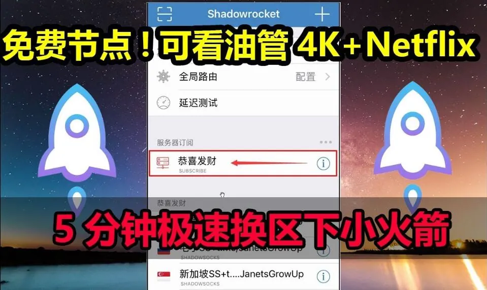
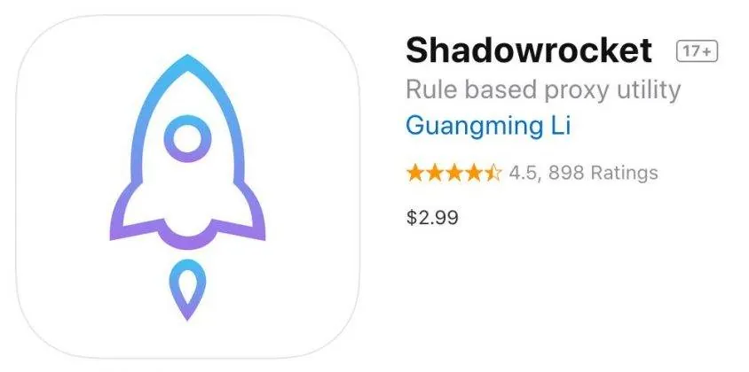

小陈去年拉了一个家庭组，六个人分摊 Apple Music 和 iCloud 空间，一年下来省了不少。上个月他看到某款剪辑 App 的年度订阅，页面上写着支持家人共享，顺手就开了。结果组里其他人打开 App，还是提示要付费。他把截图发到群里，有人回了一句：「你是不是没开购买项目共享？」他翻了半天设置，也没找到和订阅有关的开关。

这件事说明一个很常见的问题：很多人把「家庭共享」当成一个统一的功能，实际上它只是入口，真正决定某项订阅能不能被家人使用，是订阅本身、账号设置和地区规则共同作用的结果。下面按实际使用中会遇到的情况拆开来说。

## AppStore家庭共享订阅到底共享的是什么

Apple 的家庭共享（Family Sharing）是一套账号层面的组织方式。一个组织者最多可以邀请五个人组成家庭组，组内可以共享购买项目、iCloud 存储方案、位置信息、日历和部分订阅服务。

关键在于，「共享购买项目」和「共享订阅」不是同一个开关。

- **购买项目共享**：组内成员购买过的 App、音乐、影片、图书，其他成员可以看到并使用。这项功能默认开启，但组织者可以在设置里关闭。
- **订阅共享**：指的是某项订阅服务是否允许家庭成员使用。这一层由开发者决定，开发者在 App 内启用「家人共享」后，订阅才能被组内成员使用。没有启用的订阅，即使家庭组一切正常，其他成员也看不到内容。

换句话说，AppStore 家庭共享订阅能否生效，第一步要看的不是家庭组设置，而是这项订阅本身是否支持。App Store 商品页面有时会标注「支持家人共享」，但标注并不总是显眼，部分 App 需要进入订阅详情或开发者说明里确认。

## 哪些订阅通常可以共享，哪些基本不行

从实际使用经验看，可以粗略分成三类。

**苹果自家服务：大多支持，但规则不同。** Apple Music、Apple TV+、Apple Arcade 的家庭版本身就是按家庭组设计的，组内成员可以直接使用。iCloud+ 则是共享存储空间总量，不是给每个人单独一份，200GB 的方案是六个人分这 200GB，不是每人 200GB。这一点经常被误解。

**第三方 App 订阅：看开发者是否启用。** 笔记类、效率类、部分流媒体类 App 比较常见支持家人共享。工具类、专业软件类订阅往往不支持，或者只在特定档位开放。遇到不支持的情况，不是账号出了问题，而是这项订阅从一开始就没有开放共享。

**内购型订阅与消耗型项目：基本不共享。** 游戏内货币、单次解锁的功能、按次计费的服务，通常和购买者账号绑定，不进家庭组共享范围。

判断方法很直接：在 App Store 里打开该订阅的详情页，往下找「家人共享」相关说明；如果页面没有提到，进入 App 的订阅管理里也看不到家庭选项，基本可以按不支持处理。

## 开了家庭组还是用不了，通常是这几处没对上

家庭组建好了，成员也加进来了，订阅还是不能用，常见原因集中在下面几个环节。

### 成员是否真的在同一个家庭组里

家庭组邀请需要对方接受，接受后才会出现在成员列表中。有些人以为发出邀请就算加入，实际上对方可能一直没点确认。组织者可以在「设置 → 家人共享」里查看成员状态，确认每个人都是已加入，而不是待接受。

### 组织者的付款方式是否有效

家庭共享默认由组织者承担购买费用。如果组织者的付款方式失效、余额不足或账单地址异常，组内共享的购买和订阅可能受影响。部分情况下表现为成员无法使用已共享的订阅，而不是弹出明确的付款错误。

### 购买项目共享有没有被关掉

这个开关在「设置 → 家人共享 → 购买项目共享」里。如果被关闭，组内成员看不到彼此购买的 App 和订阅。有人为了隐私关掉过这个选项，后来忘了，再开新订阅时就对不上。

### 订阅是用哪个账号买的

如果订阅不是在组织者账号下购买，而是在某个成员账号下购买，共享逻辑会不一样。部分订阅只允许购买者本人使用，即使家庭组内其他成员也无法调用。购买前确认是用主账号还是个人账号操作，能减少后续麻烦。

### 地区与账号类型差异

不同地区的 App Store 在家庭共享规则上可能有差别，部分订阅只在特定地区开放家庭共享。另外，儿童账号、受限制账号在家庭组中的权限也不同，不能按成人成员的方式判断。

## 家庭组人数和切换限制，比想象中更容易踩线

Apple 家庭组上限是六人（含组织者）。这个数字本身不复杂，真正容易出问题的是切换规则。

一个 Apple ID 在同一时间只能属于一个家庭组。退出或加入新家庭组存在时间限制，通常一年内只能加入一次不同的家庭组，具体以系统提示为准。这意味着如果为了临时共享某个订阅频繁换组，很可能被卡住，短期内无法再加入新的家庭组。

实际操作中还有两个细节：

- **退出家庭组不等于订阅立刻失效。** 已共享的订阅可能在当前计费周期内仍可使用，但下一个周期不再续期，成员会收到提醒。
- **组织者退出会导致家庭组解散。** 组织者不能像普通成员那样随意退出，需要先转移组织者身份或解散家庭组。解散后所有成员都需要重新组织，已共享的订阅随之失效。

如果家庭组是为了长期分摊订阅费用，成员变动最好提前规划，避免在计费周期中途频繁调整。

## 和「共享 Apple ID」不是一回事，别混着用

搜索「AppStore家庭共享订阅」的人里，有一部分实际想找的是另一种东西：共享 Apple ID。这两者经常被混为一谈，但风险差别很大。

家庭共享是在各自账号独立的前提下，由系统允许的范围内共享购买和订阅。每个人的账号、iCloud 数据、照片、备份都是分开的，隐私边界清楚。

共享 Apple ID 则是多个人登录同一个账号。这种做法常见于购买某些只在特定地区上架的 App，或使用他人已购的订阅。问题在于：

- 同一账号在多台设备登录，可能触发安全验证，导致其中一方被要求重新验证甚至暂时锁定。
- iCloud 同步内容、照片、通讯录可能互相可见，隐私风险取决于账号使用方式。
- 账号来源不明时，原持有人可以随时改密码，使用者会被直接踢出。
- 频繁异地登录、多设备同时在线，可能被系统判定为异常行为。

如果目的是让家人在合规范围内使用同一项订阅，家庭共享是更稳的路径。如果是为了使用某个特定账号下的内容，需要清楚这属于账号共用，而不是家庭共享，两者的稳定性和风险完全不在一个层面。

## 组织者要留意的事：付款、退款和成员管理

家庭组的组织者承担的不只是邀请成员这一步。

**付款责任集中在组织者身上。** 组内成员发起的购买，默认走组织者的付款方式。如果成员误购或想退款，处理流程通常需要组织者配合。部分情况下成员可以自行申请退款，但账单归属在组织者账号下，沟通成本会更高。

**成员管理要留记录。** 谁在什么时间加入、使用了哪些共享订阅，组织者最好心里有数。家庭组人数接近上限时，新增成员可能需要先移除不活跃的人，而移除操作同样受切换限制影响。

**订阅到期提醒不要忽略。** 家庭共享的订阅到期后，成员不会自动续上，需要组织者重新购买或调整方案。如果组织者换了付款方式或账号状态变化，续期可能失败，成员端表现为突然不能用。

## 常见问题

**家庭共享订阅扣费是扣谁的？**

默认扣组织者的付款方式。成员自己账号下的独立购买，扣成员自己的费用。两者不要混淆。

**加入家庭组后，我原来的订阅会怎样？**

原有个人订阅不会自动转为家庭共享，也不会因为加入家庭组而取消。需要根据实际情况决定是否保留个人订阅，避免重复付费。

**为什么 App Store 页面没写支持家人共享，但别人说可以用？**

页面标注不一定完整，部分订阅的家庭共享信息只在 App 内订阅说明或开发者文档里体现。也有可能是版本差异或地区差异。以实际订阅页面的说明和 App 内表现为准，不要仅凭他人经验判断。

**家庭组解散后，已购买的订阅还能用吗？**

由组织者购买并共享的订阅，解散后成员通常无法继续使用。成员自己账号下购买的订阅不受影响。具体以订阅条款和系统实际状态为准。

**一个订阅能不能同时给家庭组和家庭组外的人用？**

家庭共享的范围限于组内成员。组外的人不在共享范围内，不能通过家庭共享使用该订阅。

**换区或换账号后，家庭共享还有效吗？**

Apple ID 所属地区变化可能影响家庭组状态和订阅可用性。更换主账号通常需要重新组织家庭组，原有共享关系不一定延续，操作前需要确认当前订阅的计费周期和成员安排。
