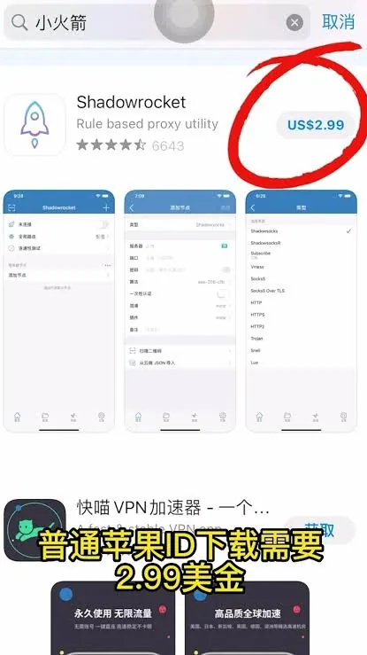

小刘想下载一款只在美区App Store上架的效率工具，结果发现自己的账号无法切换地区，这才意识到需要专门的美区Apple ID。这种情况其实很常见——很多人最初接触appleid美区，并不是因为想折腾账号，而是因为某个App、某款游戏或者某项服务只在美区提供。美区Apple ID本身并不复杂，但注册和使用过程中容易踩的坑，确实值得提前了解。

## 为什么需要美区Apple ID

美区Apple ID的核心价值，在于解锁美区App Store的内容。有些应用和游戏只在美国区上架，比如某些流媒体服务、生产力工具、教育类App，或者一些在国区被限制下载的软件。用国区ID搜索会显示“App不可用”，而用美区ID就能正常下载。

另外，美区App Store的应用生态和更新速度通常更快，部分开发者会优先在美国区发布新版本。对于经常需要跨区使用应用的用户来说，美区Apple ID几乎是必备的。

还有一类用户是为了订阅服务。有些在线服务只接受美区账号的Apple ID内购或订阅，这时候一个可用的美区ID就能解决支付渠道的问题。

## 自己注册美区Apple ID，操作上要准备什么

自己注册一个美区Apple ID是完全可行的，不需要借助第三方渠道。关键步骤是：注册时把地区设置为美国，然后填写一个美国地址。这个地址不需要真实存在，但要符合美国地址格式，否则系统可能无法通过验证。

注册流程大致如下：

- 在Apple官网或设备上点击创建Apple ID
- 填写邮箱和密码，选择地区为美国
- 填写姓名、出生日期等信息
- 设置一个美国地址（州、城市、街道、邮编）
- 完成邮箱和手机验证

需要注意，注册时如果选择“无付款方式”，可以跳过信用卡绑定。但前提是注册流程中必须选对地区，并且地址信息填写完整。部分情况下，如果设备上的App Store地区与账号地区不一致，可能出现提示异常的情况，需要先切换设备上的App Store地区。

注册完成后，这个美区ID就可以用来登录App Store，下载美区应用。但要注意，同一个Apple ID不能同时用于iCloud和App Store登录不同地区，如果需要使用美区ID下载应用，建议只在App Store中登录，iCloud仍使用国区ID，这样更安全。

## 注册时支付方式填不了怎么办

这是很多人卡住的地方。注册美区Apple ID时，如果选择“无付款方式”失败，或者后续购买应用时提示需要绑定支付方式，通常是因为账号缺少有效的美国支付信息。

解决方案有几个。一是使用美国礼品卡充值。通过正规渠道购买美区App Store礼品卡，充值到账号余额后，购买应用和订阅时直接从余额扣除，不需要绑定信用卡。二是使用虚拟信用卡，但这类卡片需要真实可用的美国账单地址，且部分虚拟卡可能被Apple风控拦截，使用前需要确认支持App Store支付。三是找有美国信用卡的朋友帮忙绑定，但这依赖个人关系，不适合所有人。

需要特别提醒的是，任何声称可以“绕过支付验证”或“提供内部通道”的服务，都存在账号被风控的风险。Apple对异常支付行为有严格的检测机制，一旦触发，账号可能被限制购买甚至封禁。所以，礼品卡充值是最稳妥的方式，但也要选择正规渠道购买，避免购买来路不明的充值卡。

## 共享美区ID省事，但风险要提前了解

有些人不想自己注册，会选择使用共享的美区Apple ID。共享ID确实方便，不需要自己准备地址和支付方式，登录后就能下载应用。但共享ID的风险比很多人想象的要大。

首先是账号安全问题。共享ID意味着多个人共用同一个账号，如果其中一个人修改了密码，其他人就登不进去了。而且Apple ID关联个人数据，共享ID可能暴露你的下载记录、购买记录，甚至部分隐私信息。

其次是稳定性问题。共享账号经常出现“账号被锁定”或“需要验证”的情况，因为Apple检测到多设备同时登录，可能触发安全验证。一旦账号被锁定，需要原持有人通过邮箱或密保问题解锁，共享用户往往无能为力。

还有一个问题是地区绑定。有些共享ID可能已经被设置过家庭共享或地区限制，导致你无法正常下载某些应用。更严重的是，如果共享ID的来源不明，比如是从某些非正规渠道获得的，可能存在被原持有人随时收回的风险，届时你下载的应用可能无法更新，甚至无法打开。

如果确实需要使用共享ID，建议只用于App Store下载，不要登录iCloud，不要绑定任何支付方式，也不要在共享ID中保存任何个人信息。使用前先确认账号能正常下载目标应用，使用后及时退出。

## 美区ID使用中容易忽略的几个细节

拿到美区ID后，使用过程中的细节往往决定了体验好坏。

第一，设备上的App Store地区需要与账号地区匹配。如果设备地区是国区，但账号是美区，下载时可能出现提示“此项目在你所在地区不可用”。这时候需要把App Store的地区切换为美国，但切换地区会清除已下载应用的更新队列，部分应用可能无法正常更新，需要重新下载。

第二，更新应用时可能出现问题。美区ID下载的应用，后续更新时如果账号被锁定或无法登录，应用会一直显示等待中。所以使用共享ID的用户，最好在下载完成后就退出登录，下次更新时再重新登录。

第三，账号安全设置。如果是自己注册的美区ID，建议开启双重验证，绑定可靠的手机号和备用邮箱。如果账号被盗，没有双重验证的保护，找回难度会大很多。

第四，不要频繁切换账号。一天之内多次登录退出不同Apple ID，可能触发Apple的风控机制，导致账号被临时限制登录。这是很多共享ID用户遇到的“掉线”问题的原因之一。

第五，关于地区切换。如果你打算长期使用美区ID，可以保持App Store地区为美国。但如果你的主要账号是国区，iCloud和App Store使用不同账号，就需要在切换时注意不要影响iCloud数据同步。

## 美区Apple ID的常见问题

### 美区Apple ID必须用美国信用卡吗
不是。注册时可以选择无付款方式，后续购买可以用美区礼品卡充值，不一定要绑定信用卡。

### 共享美区ID会被封号吗
有可能。如果共享ID被多人同时使用，Apple可能触发异常登录检测，导致账号被锁定或限制购买。来源不明的共享ID风险更高。

### 自己注册的美区ID能长期用吗
可以。只要账号信息完整、登录环境稳定、支付方式合规，长期使用没有问题。但要注意不要频繁切换地区或设备。

### 美区ID和国区ID能同时用吗
可以。iCloud用一个ID，App Store用另一个ID是常见做法。但需要注意，部分系统功能（如查找我的iPhone）依赖iCloud账号，App Store账号不影响这些功能。

### 注册美区ID时地址怎么填
需要填写一个符合美国格式的地址。可以使用免税州的地址，比如蒙大拿州、俄勒冈州等，这样可以减少后续购买时的税费问题。但地址不必是真实存在的，只要格式正确即可。

美区Apple ID本身是一个工具，用得好能解决很多跨区应用需求，用不好则可能带来账号安全和隐私风险。自己注册虽然流程稍长，但长期来看更可控；共享ID省事，但需要接受稳定性和安全上的不确定性。根据实际需求选择，并提前了解清楚使用中的细节，才能让这个ID真正为你服务。
