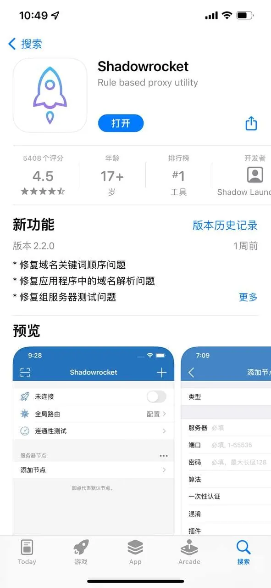

有读者在后台留言，说想装一个只在美区上架的工具类App，搜到一堆“2025苹果id账号共享免费”的帖子，照着里面给的账号密码登进去，结果不是提示密码错误，就是卡在双重验证，还有一次登完退出后，自己手机相册里莫名多出几张陌生人的截图。他问：这类免费共享ID到底能不能用，问题出在哪。

先把结论放前面：这类账号在部分情况下确实能完成一次下载，但它解决的问题非常有限，带来的麻烦却常常超出预期。下面按实际使用中会遇到的情况，把这件事拆开讲。

## 搜到的“免费共享ID”通常是什么东西

所谓苹果ID账号共享，指的是有人把自己注册的 Apple ID 账号密码公开或半公开地放出来，让多个人同时登录使用。免费的那一类，常见于论坛帖子、社群文件、聚合类页面，账号多为美区、港区或日区，用途基本只有一个：登录 App Store 下载某个特定应用。

它和你自己注册的 Apple ID 有本质区别。你自己的账号绑定了手机号、邮箱、支付方式，有完整的找回路径；共享账号的注册资料往往是批量生成的，邮箱可能已经失效，密保问题没人知道答案，一旦出问题，谁都找不回来。

免费共享的账号还有一层特殊之处：密码是公开的，任何人拿到都能改。今天发出来的密码，明天可能已经被前一个使用者改掉，或者被平台风控锁定。这不是偶然现象，而是公开密码这种模式必然导致的结果。

## 2025苹果id账号共享免费为什么总在登录环节卡住

真正让人放弃的，往往不是“能不能下载”，而是登录这一步就过不去。常见的有几种情况。

**密码失效或被修改。** 账号公开传播后，总有人会改密码占为己有，或者尝试绑定自己的手机号。发帖人如果不持续维护，账号很快就不能用了。

**触发双重验证。** 苹果对异地、多设备、频繁登录的账号会要求输入验证码，验证码发往账号绑定的手机号或受信任设备，而这些信息掌握在注册者手里，普通使用者拿不到。

**账号被锁定。** 短时间内多个 IP、多台设备登录同一个 Apple ID，容易被判定为异常行为。锁定后需要回答安全问题或通过邮件验证，共享账号基本无法完成。

**设备被挤下线。** 同一个账号在太多设备上登录，先登录的会被要求重新验证。有人下载到一半被踢出来，进度直接断掉。

这些问题的共同点是：它们都不属于“运气不好”，而是共享模式本身决定的。一个账号同时被几十上百人使用，稳定性不可能好。

## 登录共享ID时，哪些操作会把风险带给自己

很多人以为只是登个 App Store，不会影响别的。实际情况要看你在哪个位置登录。

**只在 App Store 登录，风险相对可控。** 设置里明确区分了 iCloud 与 App Store 两个登录入口，只在 App Store 登录，一般不会同步你的照片、通讯录、备忘录。下载完成后退出账号即可。

**一旦登进设置顶部的 Apple ID，问题就复杂了。** 这个入口关联 iCloud、查找、设备备份。用别人的账号登录后，你的部分数据可能进入对方的 iCloud 空间；如果对方开启“查找”，理论上存在远程锁定设备的可能。这类操作在任何情况下都不建议尝试。

**不要绑定自己的手机号或支付方式。** 有人为了方便接收验证码，把自己的号码绑到共享账号上。账号后续被其他人使用时，你的号码会持续收到验证码，也可能被用来做其他验证。解绑过程还不一定顺利。

**留意已购项目和下载记录。** 用共享ID下载的 App，后续更新时可能仍要求输入该ID的密码。账号一旦失效，更新就卡住，只能删除重装。如果你用这个ID下载了大量应用，迁移会很麻烦。

## 共享ID和独享账号，差别不只是价格

| 对比项 | 免费共享ID | 独享账号 |
| --- | --- | --- |
| 同时在线人数 | 多人共用，数量不可控 | 通常仅一人使用 |
| 密码控制权 | 公开，任何人可改 | 归使用者所有 |
| 被锁定概率 | 较高 | 相对较低 |
| 双重验证 | 验证码难以获取 | 可绑定自己的联系方式 |
| App更新 | 依赖原账号可用 | 自己掌握 |
| 售后 | 基本没有 | 视渠道而定 |
| 隐私风险 | 取决于登录位置和使用方式 | 可控 |

这张表不是要否定免费共享的价值。临时下载一个应用、用完就退出，它的成本确实最低。但如果你需要长期使用某个外区应用、需要稳定更新，或者不愿意承担账号随时失效的不确定性，共享ID就不是合适的选择。

选择时还有一点容易被忽略：**账号所属地区是否与你要下载的应用一致**。美区ID下不了日区独占的应用，这一点在拿到账号前就该确认，而不是登录后才发现。

## 拿到一个共享ID后，先做哪几项确认

如果确实要试，至少把这几个动作做在前面。

- 确认登录位置：只在 App Store 的账号入口登录，不碰设置顶部的 Apple ID。
- 确认账号地区：在 App Store 页面底部查看当前账号所属国家或地区，与目标应用的上架区一致再下载。
- 确认能否正常退出：下载完成后立即退出，不要长时间保持登录状态。
- 不保存、不转发：把账号密码存在自己设备里、或再转给别人，只会加速账号失效。
- 不绑定个人信息：手机号、邮箱、支付方式一律不绑。
- 观察账号状态：如果登录时反复要求验证、提示锁定，直接放弃，不要反复尝试，反复试只会让锁定更快发生。

## “免费”背后的两个现实问题

第一个问题是维护成本。一个能正常使用的 Apple ID 需要有人注册、维护、处理被改密码和被锁定的情况。免费共享没有收入支撑这套维护，账号质量只能靠发布者的个人意愿。这就是为什么免费账号的平均可用时间通常很短。

第二个问题是来源。公开传播的账号，你无法确认它是怎么注册的、绑定了什么、之前被谁用过。部分账号可能涉及批量注册或来源不明的资料，使用这类账号本身就有不确定性。遇到要求你提供自己手机号接收验证码、或让你帮忙“解封”的，更应该直接绕开。

如果你的需求是长期使用外区应用，更稳妥的路径其实有两条：一是自己注册一个对应地区的 Apple ID，按官方流程填写信息、支付方式选择“无”，账号完全由自己掌握；二是选择明确说明使用范围、能提供后续处理的独享账号渠道，并在使用前问清楚地区、是否可改密码、异常时怎么处理。这两条路都比反复试免费共享账号省时间。

## 几个常被问到的问题

**用共享ID下载的App，以后还能更新吗？**
更新时通常需要输入下载时所用账号的密码。账号还有效就能更新，失效后只能删除应用，用自己的账号重新获取。所以重要应用不建议用共享ID下载。

**登录共享ID会看到别人的照片吗？**
只在 App Store 登录不会。登进设置里的 Apple ID 并开启照片同步的情况下，才可能出现数据混入。这也是前面反复强调登录位置的原因。

**免费共享ID能长期使用吗？**
按实际经验，长期稳定的可能性很低。密码公开、多人同时在线、验证码不可控，这三点决定了它更适合一次性临时用途。

**国区账号和外区账号能同时存在吗？**
可以。App Store 允许切换账号，切换后已下载的应用一般不受影响，但更新会跟随下载时使用的账号。切换前记清楚每个应用是用哪个ID获取的，能省掉后面不少麻烦。

回到开头那位读者的情况，他遇到的问题不是操作失误，而是这类账号的常态。免费共享ID可以当作一次性的临时工具，但不适合当作长期依赖。真正需要稳定使用的时候，把账号控制权握在自己手里，比反复寻找下一个“还能用”的共享密码要省心得多。
