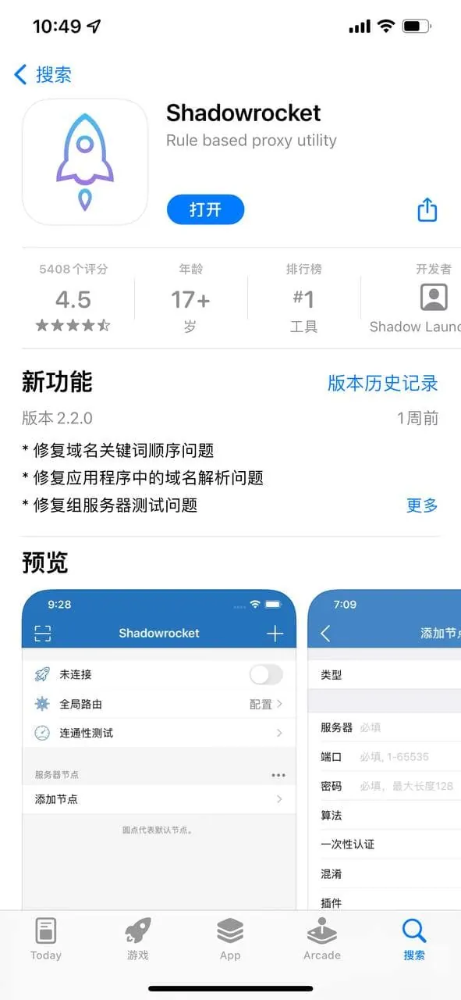

很多人第一次接触小火箭（Shadowrocket）时，都会遇到同一个问题：国区App Store里搜不到这个应用。原因很简单，小火箭并没有在中国大陆区上架，想要安装它，得有一个海外地区的Apple ID。于是，不少人会选择去购买或借用共享的Apple ID来下载，也就是大家常说的「AppleID共享小火箭」。

这个思路本身没问题，但共享ID和独享账号在使用体验上有很大差别。登录方式、更新频率、掉线概率、账号安全，每一项都值得在动手之前先弄清楚。这篇文章就从实际使用出发，把共享Apple ID下载小火箭这件事讲明白。

## 小火箭为什么必须用海外Apple ID

小火箭是一款iOS网络调试工具，它的主要功能是让用户通过配置代理规则来管理设备网络连接。这类工具在国区App Store的审核政策下无法上架，因此苹果官方商店里根本搜不到它。想安装，只能切换到其他地区的App Store账户，比如美区、港区、日区等。

这里有一个常见的误区：很多人以为小火箭需要“越狱”或者“企业签名”才能装，实际上完全不用。只要你的Apple ID所属地区支持小火箭上架，直接登录App Store搜索下载即可。问题在于，绝大多数国内用户没有海外Apple ID，所以才会去找共享账号。

共享Apple ID的本质，就是一个人注册了海外区账号，然后把账号密码分享给其他人使用。大家共用同一个账号登录App Store，各自下载小火箭，再用自己的设备独立运行。听起来很方便，但实际操作中会遇到不少麻烦。

## 用共享Apple ID登录App Store时要注意什么

拿到共享账号后，第一步就是登录。这里最需要留意的是登录位置——**只在App Store登录，不要在iCloud登录**。

很多人顺手就在设置里输入了账号密码，结果Apple ID直接登录到了iCloud，照片、通讯录、备忘录都有可能开始同步。一旦账号主人修改密码或开启双重验证，你的设备可能会被远程锁定，甚至影响到你手机里原有的个人数据。这是共享ID最容易被忽视的风险点。

正确的操作方式是：

- 打开App Store，点击右上角头像
- 退出当前账号（如果有）
- 输入共享的Apple ID和密码
- 搜索Shadowrocket并下载
- 下载完成后，退出账号

如果只是临时下载，下载完就退出，后续使用基本不会受到账号状态影响。但如果你希望以后能直接更新小火箭，就需要保留账号登录状态，这就引出了下一个问题。

## 共享Apple ID下载小火箭后，App更新怎么办

小火箭这类应用更新频率不算低，尤其是系统版本大更新后，开发者往往会跟进修复兼容性问题。如果你下载完就退出了共享账号，App Store里会提示“此App已不再提供”或需要输入密码才能更新。

这时候你有两个选择：

一是重新登录共享账号，让App Store识别到已购项目，然后点击更新。前提是共享账号的密码没有被修改，账号也没有被锁定。如果账号主人经常改密码，或者账号被苹果风控冻结，更新就会变得非常麻烦。

二是干脆不更新。小火箭旧版本在很多场景下依然能正常工作，只要你的iOS系统没有跨大版本升级，旧版本通常不会立刻失效。但这不是长久之计，一旦系统更新导致兼容性问题，你就得被迫去找新的共享账号。

所以，如果你打算长期使用小火箭，并且不想每次更新都折腾一遍，最好考虑独享账号，或者找一个能稳定提供售后支持的渠道。共享ID适合临时体验或短期使用，不适合作为长期依赖。

## 小火箭共享ID会不会掉线或被封

这是共享用户最关心的问题。答案是：**有可能**。

共享Apple ID的稳定性取决于很多因素，比如使用人数、登录设备数量、账号来源是否正规等。苹果对同一账号的登录设备数量有限制，如果同时在线设备过多，系统会判定异常登录，要求验证身份或直接锁定账号。一旦账号被锁，所有使用这个ID下载的应用都会受到影响，小火箭也不例外。

常见的异常情况包括：

- **无法下载**：提示“此Apple ID已被锁定”或“需要验证”
- **无法更新**：更新时要求输入密码，但密码已经失效
- **App闪退**：部分情况下，账号异常会导致已下载的应用无法正常启动
- **频繁掉线**：如果你的小火箭需要登录账号才能使用，账号异常会导致配置失效

另外，共享ID还有一个隐性风险：账号主人可以随时修改密码、开启双重验证，或者通过“查找”功能远程移除设备。这些操作都会直接影响你的使用体验，而且你无法控制。

## 如何判断一个共享Apple ID靠不靠谱

既然要共享，就得选一个相对可靠的来源。这里有几个判断维度可以参考：

**看账号是否提供长期售后。** 靠谱的卖家或分享者通常会说明账号的使用期限、是否支持更新、密码多久换一次。如果对方只给你一组账号密码，然后就不管了，那风险会高很多。

**看账号登录设备数量。** 如果一个账号被同时分发给几十上百人使用，被锁的概率会大大增加。好的共享账号通常限制同时在线设备数，或者定期更换密码来维持稳定性。

**看是否支持换绑或提供备用账号。** 有些共享服务会提供多个备用账号，一旦主账号失效，可以切换到备用账号继续使用。这比单账号更稳妥。

**看账号地区。** 不同地区的小火箭版本在功能上基本一致，但部分地区可能对App Store账号有额外验证要求。美区和港区相对稳定，其他地区需根据实际情况判断。

需要注意的是，以上判断标准并不能保证账号绝对安全。共享ID本质上就是共用他人身份，风险始终存在，只是程度不同。

## 小火箭共享ID使用时需要留意的安全问题

除了账号本身，共享ID还涉及个人隐私和数据安全。以下几点值得特别注意：

**不要登录iCloud。** 前面已经强调过，共享账号只用于App Store下载，绝不要输入到iCloud设置里。一旦同步开启，你的私人数据会出现在他人设备上。

**不要开启双重验证。** 如果你的设备登录了共享ID，并且系统提示开启双重验证，不要操作。开启后，验证码会发送到账号主人的设备上，你无法接收，反而会导致账号无法正常使用。

**不要在公共设备上保存密码。** 如果你在朋友的手机或公共电脑上登录过共享账号，记得退出并清除保存的密码，避免账号被他人误用。

**注意账号密码的来源。** 如果账号来自不明网站或非正规渠道，可能存在被盗用风险。最好通过熟人推荐或信誉较好的渠道获取。

**定期检查已购项目。** 登录共享账号后，可以到App Store已购项目中查看是否有异常应用。如果发现账号下有不明App，说明这个账号可能被多人滥用，建议谨慎使用。

## 独享账号和共享ID怎么选

如果你还在犹豫选哪种，可以参考这个简单的对比：

| 对比维度 | 独享账号 | 共享ID |
|---------|---------|--------|
| 稳定性 | 高，账号只属于自己 | 低，受他人影响大 |
| 更新体验 | 随时更新，无需重新登录 | 需重新登录共享账号 |
| 安全风险 | 低，数据完全隔离 | 高，存在隐私泄露风险 |
| 价格成本 | 较高 | 较低 |
| 适合场景 | 长期使用、依赖更新 | 短期体验、临时使用 |

选择的核心逻辑很简单：如果你只是好奇小火箭的功能，想试试看，共享ID够用。如果你打算长期用它来管理网络连接，并且不希望频繁被账号问题打断，独享账号会更省心。

## 关于小火箭共享ID的常见问题

### 共享Apple ID能同时几个人用

没有固定上限，但同一时间登录的设备越多，账号被锁定或要求验证的概率越大。一般来说，一个账号同时在线设备控制在个位数会比较稳定。

### 用共享ID下载小火箭后，退出账号会影响App使用吗

不会。小火箭下载完成后，应用本身已经安装到设备上，退出App Store账号不影响已安装App的正常运行。只有更新时才需要重新登录。

### 共享ID登录iCloud会有什么后果

可能导致你的私人数据被同步到账号主人的云端，或者你的设备被远程管理。最严重的情况下，账号主人可以远程锁定你的设备，甚至抹除数据。所以无论如何都不要在iCloud登录共享账号。

### 小火箭更新时提示需要密码，但密码不对怎么办

这说明共享账号的密码已被修改，或者账号已被苹果锁定。这种情况下，已安装的小火箭通常还能继续使用，只是无法更新。如果必须更新，只能换一个可用的共享账号，或者考虑独享账号。

---

共享Apple ID下载小火箭，本质上是用便利性换取成本。它确实能让你以很低的成本体验到小火箭的功能，但代价是账号稳定性、更新便利性和隐私安全都不可控。如果你能接受这些限制，共享ID完全可以作为起步方案。如果你需要的是稳定、长期、无干扰的使用体验，独享账号是更合适的选择。无论选择哪种，记住一点：**账号来源要可靠，iCloud绝不登录，密码不要随便改。**
